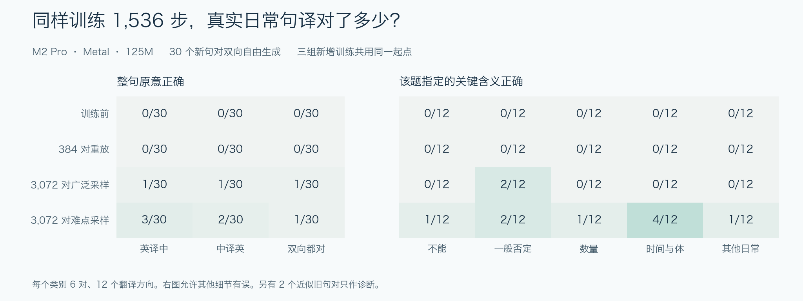
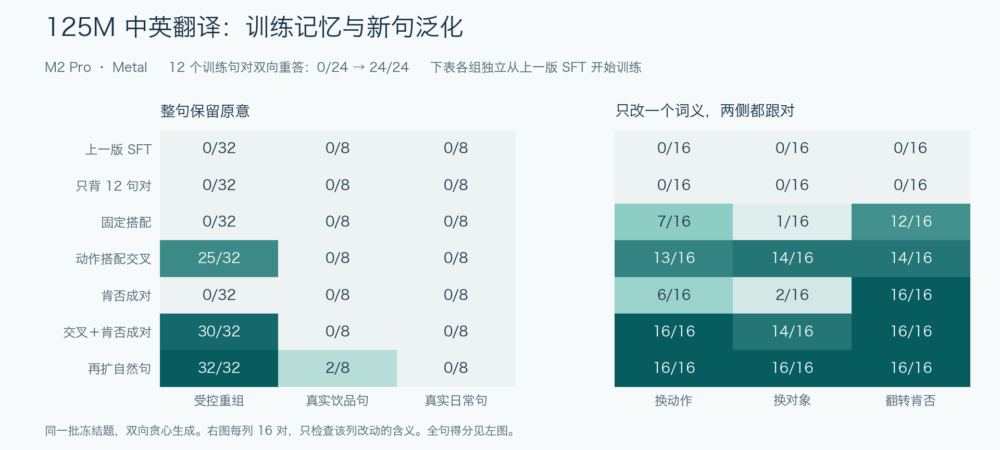
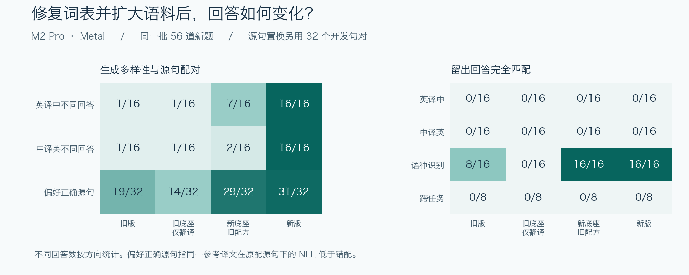
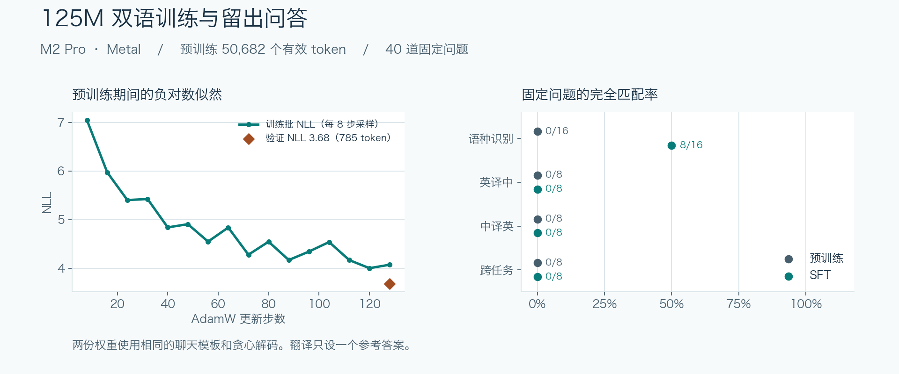
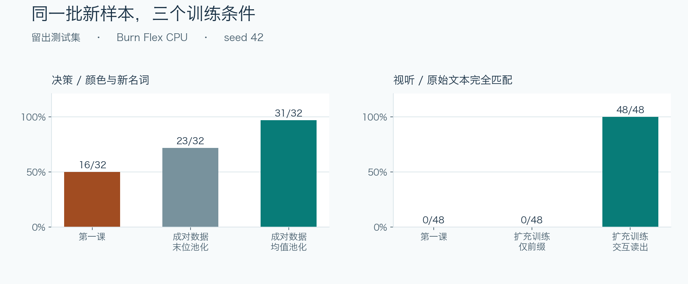
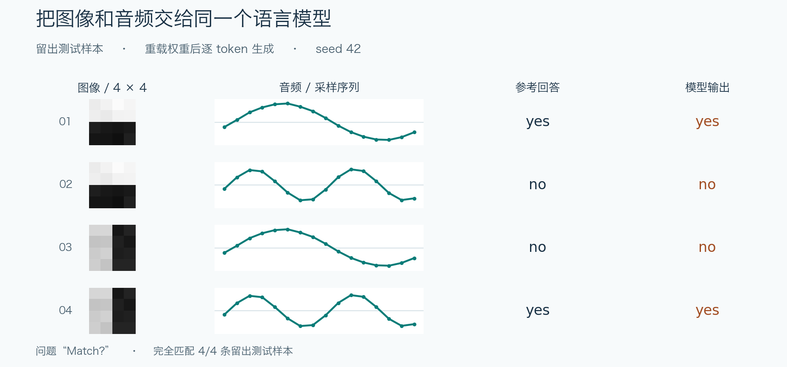

# MetaI — 面向 2026 前沿的全链路大模型研发框架

MetaI 以 Rust、Burn 0.22 和 CubeCL 构建模型架构、训练、对齐与推理的共同底座。工程目标从单机 **125M 原型**延伸至 **百万 token 上下文和万亿参数 MoE 集群**。仓库里的 CPU 小模型承担算法回归与中文教学，单机加速器承担原型训练，面向集群的性能结论以真实硬件测量为准。

## 当前工程能力

| 方向 | 仓库中可以运行的能力 | 工业目标 |
| --- | --- | --- |
| 架构与长上下文 | 可配置 GQA、MLA、RoPE、SwiGLU、共享和路由专家、稀疏选择与缓存解码 | V4 规格的 CSA/HCA、百万上下文预训练与推理、无辅助损失均衡、mHC 与 MTP |
| 加速与训练 | CubeCL Metal GPU 上完成 125,276,928 参数模型的前向、反向、AdamW 更新、验证和保存。CUDA 入口接入 CubeCL。可记录参数量、有效 token、全局批量与分配器用量 | 多机 DDP、EP/TP、All-to-All、通信重叠以及 BF16 / FP8 / NVFP4 分层精度 |
| 同步与恢复 | `train-cluster` 支持单进程本地副本同步、梯度累积，按全局有效 token 数归约。支持多份训练语料、磁盘 token 分块及 epoch 恢复 | 跨机通信、分片优化器状态、故障恢复、吞吐与扩展效率 |
| 对齐与决策 | SFT、LoRA、DPO、PPO、GRPO、GSPO、CISPO、规则与 AI 反馈、工具交互、自适应计算、蒸馏与校准决策头 | 大规模 rollout、DAPO、长轨迹过程监督、生产任务的质量与校准 |
| 推理与模态 | 分页 KV 缓存、独立草稿模型的投机解码、INT4 量化入口、视觉与音频问答、线性与扩散模型实验 | MTP 草稿头、低精度内核、专家卸载、开放域多模态质量与服务指标 |

DeepSeek 官方的 V4-Pro 参考规格为 **1.6T 总参数 / 49B 激活**，V4-Flash 为 **284B / 13B**，两者均标注 1M 上下文。MetaI 以这些规模作为架构和系统设计目标。指标归属、实现差异和验收条件见 [工业规格与实机记录](docs/INDUSTRIAL.zh-CN.md) · [项目路线](docs/PROJECT_ROADMAP.zh-CN.md) · [DeepSeek 官方模型卡](https://huggingface.co/deepseek-ai/DeepSeek-V4-Pro)。

## 同样训练 1,536 步，真实日常句译对了多少？

**在 M2 Pro 的 Metal GPU 上，难点采样组把 60 道新翻译题的整句语义通过数从 0 提高到 5，广泛采样组为 2。30 个真实句对中，只有 1 对两个方向都译对。** 难点组的 5 条中有 2 条仍明显重复或有语法错误，当前权重仅能译对少量日常表达。

三组从上一轮的同一份 125M 扩充权重开始，各训练 1,536 步，使用相同的批量、学习率和种子。两大组各训练 3,072 个授权真实句对，共享 2,254 对。难点组提高了能力否定、数量、时间及问句等表达的占比。主评测每类 6 个句对，每对都译两个方向。每个答案分别核对整句和该题指定的关键含义。[冻结语料与逐句署名](examples/daily-v4/README.md)

| 权重 | 英译中整句正确 | 中译英整句正确 | 关键含义正确 | 双向都正确的句对 |
| --- | ---: | ---: | ---: | ---: |
| 训练前 | 0/30 | 0/30 | 0/60 | 0/30 |
| 384 句对反复训练 | 0/30 | 0/30 | 0/60 | 0/30 |
| 3,072 句对广泛采样 | 1/30 | 1/30 | 2/60 | 1/30 |
| 3,072 句对难点采样 | **3/30** | **2/30** | **9/60** | **1/30** |

| 真实留出原句 | 训练前原答 | 难点组原答 | 按原意判定 |
| --- | --- | --- | --- |
| 我沒想那麼說。 | `I'm not guilty of anything.` | `I didn't mean to say that.` | ✓ 保留了“无意那么说”，反向也正确 |
| `They got here yesterday.` | 他們在這裡這裡等。 | 他們昨天到這裡。 | ✓ 到达、人物和时间均正确 |
| `We can't talk here.` | 我们提供。 | 我们不能跟你说！ | ✗ 限制从地点变成了听者 |
| `I'm three years younger than you are.` | 我比你比你比你。 | 我比你多三歲。 | △ 年龄差三岁正确，长幼关系颠倒 |
| 你还记得我们吗？ | `Why did you have tea?` | `Do you remembering us?` | 语义通过，英文动词形式错误 |

数量类整句正确仍为 **0/12**。时间类有 **4/12** 保住了指定时间或体及其对应事件，只有 **1/12** 把整句译对。另有两个近似旧语料的句对单列诊断。仓库保留四份权重对全部 32 对的 256 条原始回答、逐句判定、token ID 和训练收据。[全部译文与理由](docs/experiments/daily-v4-answers.md) · [训练与评测教程](docs/DAILY_TRANSLATION.zh-CN.md) · [机器可读报告](docs/experiments/daily-v4.json)



## 125M 能记住译文，也能翻译没见过的词语搭配吗？

**在 M2 Pro 的 Metal GPU 上，125M 把 12 个真实训练句对双向重译，24/24 与参考逐字一致。用训练前冻结的新题测试，扩充组在 32 道受控重组题上译对 32 道，在 16 道真实句上完整保留原意的有 2 道。** 只背这 12 对的权重遇到同一批 48 道新题，整句通过 0 道。扩充组在真实饮品句上为 2/8，在其他日常句上为 0/8。两道成功例子都能在前期语料中找到措辞相近、饮品不同的句子。当前能力集中在见过的词和句式附近。

| 从上一版 125M SFT 出发的独立训练组 | 新动作与对象搭配，整句正确 / 32 | 只换动作，两端正确 / 16 | 只换对象，两端正确 / 16 | 翻转肯否，两端正确 / 16 | 真实句，整句正确 / 16 |
| --- | ---: | ---: | ---: | ---: | ---: |
| 上一版 SFT | 0 | 0 | 0 | 0 | 0 |
| 固定动作与对象搭配 | 0 | 7 | 1 | 12 | 0 |
| 只交叉动作与对象 | 25 | 13 | 14 | 14 | 0 |
| 只增加同一事件的肯否对照 | 0 | 6 | 2 | 16 | 0 |
| 交叉搭配＋肯否成对 | 30 | 16 | 14 | 16 | 0 |
| 交叉＋肯否，并追加 256 个真实句对 | **32** | **16** | **16** | **16** | **2** |

中间四组各训练 352 步，每个动词、饮品和肯否的出现次数相同。只让一个动作配一个对象时，“妮娜喜欢果汁。”被译成 `Nina likes coffee.`，反方向 `Nina likes juice.` 却得到“妮娜喝果汁。”。交叉搭配后两句都正确。只练固定肯否时，`Nina wants juice.` 和它的否定句都被译成“妮娜不想要果汁。”。给同一事件同时提供肯定与否定，两句才被区分。最后一组共训练 864 步，增加语料和更新量的作用在该组无法拆开。

| 留出原句 | 上一版 SFT 实答 | 扩充组实答 | 按原意判定 |
| --- | --- | --- | --- |
| `Nina does not want juice.` | 沒有錢。 | 妮娜不想要果汁。 | ✓ 人物、意愿、对象、否定均正确 |
| 利奥喝茶。 | `She was a lot of the room.` | `Leo drinks tea.` | ✓ 谁喝什么均正确 |
| `I'm drinking milk.` | 我很抱歉。 | 我正在喝牛奶。 | ✓ 同义表达，保留进行状态 |
| 你喝啤酒吗？ | `Would you like to do this?` | `Do you drink beer?` | ✓ 保留对象和提问意图 |
| `I can't drink milk.` | 我不能让我们不能的。 | 我不喝牛奶。 | ✗ 不喝与不能喝含义不同 |
| `I bought a dozen pencils today.` | 我請這個人個人個人。 | 我买了一支钢笔，但我把它丢了。 | ✗ 数量、物品、时间错误，还新增丢笔情节 |

真实句对由 Tatoeba 的 CK、GlossaMatik、notabene、egg0073、Martha 等贡献者署名授权。32 道受控题为 16 个训练中未出现的完整句对，每对测两个方向。16 道真实题每对只测一个方向，两侧均与历轮数据去重。全部评测采用自由生成、固定种子的一次训练和逐句语义判定。[逐题译文与署名](docs/experiments/translation-v3-answers.md) · [数据、权重摘要和 token 记录](docs/experiments/translation-v3.json) · [实验教程与复现命令](docs/TRANSLATION.zh-CN.md)



## 修复分词器后，125M 模型的翻译改善了多少？

**模型学会了区分中英文，也会随原句改变回答。32 道新翻译题中，新旧模型完整传达原意的都为 0 道。** 两版在同一台 M2 Pro 的 Metal GPU 上、用同一批新题贪心解码。每个方向各有 16 个全新句对；测试还包括 16 道语种识别和 8 道算术、常识、阅读、抄写题。所有测试原句与两轮训练数据按规范化原文和句子 ID 去重。[逐题语义复核](docs/experiments/m2-bilingual-v2-review.json)

| 56 道新题上的指标 | 旧 SFT | 新 SFT |
| --- | ---: | ---: |
| 16 个英译中原句产生的不同回答数 | 1 | 16 |
| 16 个中译英原句产生的不同回答数 | 1 | 16 |
| 保留原意的翻译（单评阅者逐句核对） | 0/32 | 0/32 |
| 语种识别（完全匹配） | 8/16，恒答“中文” | 16/16，中英各 8/8 |
| 训练任务以外的短答（完全匹配） | 0/8 | 0/8 |

| 留出原句 | 旧 SFT 原答 | 新 SFT 原答 | 丢失的含义 |
| --- | --- | --- | --- |
| `Yesterday was cloudy.` | `" 中文"` | `"你應該要的。"` | 时间和天气均未译出 |
| `I want something sweet.` | `" 中文"` | `"我想要一樣。"` | 保留“想要”，遗漏“甜的” |
| 他比你大兩歲。 | `" I don't have a little money."` | `"He is a lot of you."` | 遗漏年龄比较和两岁的差值 |
| 我咳嗽。 | `" I don't have a little money."` | `"I'm sorry."` | 把症状译成了道歉 |

表中句对由 CK、CM、Martha、xjjAstrus 贡献。引号内保留原始空格。完整报告提供原句、参考译文、署名、各权重生成的 token ID 和停止原因。[原始回答与对照](docs/experiments/m2-bilingual-v2.json) · [双语实验教程和重放命令](docs/M2_BILINGUAL_V2.zh-CN.md)



**分词器。** 旧词表缺少 89 个基础字节。修复后的词表保持 16,000 项，`青橙47`、`MAPLE-731`、全部十个数字、标点、组合字符及空白均能逐字往返。测试覆盖 256 个字节符号、全部 Unicode 标量值和 22,912 条真实中英原句，差异为零。旧权重继续使用自身目录中的分词器。[检查记录](docs/experiments/m2-bytelevel-v2.json)

**为什么旧 SFT 总答同一句？** 旧版 256 条训练记录有 256 个不同的提示编码，全部都放得进上下文。对开发集的 32 条参考译文，只换成同方向另一句原文，旧 SFT 的平均 NLL 仅升高 **0.004**；两道缓存与完整前缀重算的贪心输出也逐 token 一致。旧模型主要学到了任务常见的回答，对具体源句的依赖很弱。固定旧底座、同一批句对和 64 次更新，把全部语种题改成翻译后，英译中的固定回答从“中文”变成“你必間。”，中译英仍逐字重复原先关于钱的句子。标签配比影响了它重复什么，移除标签仍然会重复。在新底座上重放旧 SFT 配方，英译中、中译英出现 7 种和 2 种回答；扩大双向监督后才都达到 16 种。此时置换原文使 NLL 平均升高 **0.767**，32 题中有 31 题更偏好正确源句。

**实机训练。** 同一套 125,276,928 参数模型从随机权重重训。预训练使用 8,192 个授权句对、209,076 个目标 token，耗时 178 秒，验证 NLL 为 3.468。SFT 使用另外 3,072 个句对，生成 6,144 条双向翻译和 768 条语种指令，训练两轮共 147,684 个监督 token，耗时 370 秒。Tatoeba 语料采用 CC BY 2.0 France，原句、作者和 ID 均随冻结子集提供。[语料与逐句署名](examples/m2-bilingual-v2/README.md)

<details>
<summary>第一版 125M 双语权重及当时的 40 道留出题</summary>


在 Apple M2 Pro 的 Metal GPU 上，从随机权重训练了 **125,276,928 参数**的模型。预训练使用 Tatoeba 的 2,048 个中英句对，共 50,682 个有效目标 token，耗时 135 秒。SFT 从该权重继续训练，用另外 256 个句对生成翻译和语种识别指令，训练两轮，共 4,134 个回答及 EOS 目标，耗时 60 秒。选用的原句按 CC BY 2.0 France 授权，逐句保留作者和 ID。[冻结语料与署名](examples/m2-bilingual-v1/README.md)

**它能利用同域上下文预测后一个 token，还不能可靠地翻译或问答。** 在独立验证的 785 个目标 token 上，预训练模型的 NLL 为 **3.682**，仅按训练语料词频预测的基线为 **6.257**，越低越好。换成训练前固定的 40 道问题，两份权重的自由生成结果如下。

| 留出任务 | 预训练 | SFT 后 | 实际表现 |
| --- | ---: | ---: | --- |
| 英译中 | 0/8 | 0/8 | 8 个不同的新英文句子都得到“中文” |
| 中译英 | 0/8 | 0/8 | 8 个不同的新中文句子都得到同一句关于钱的英文 |
| 语种识别 | 0/16 | 8/16 | SFT 对 16 题都答“中文”。中文 8/8、英文 0/8，等于恒猜基线 |
| 算术、常识、阅读、抄写 | 0/8 | 0/8 | 每项各有中英文一题，4 个参考答案含词表无法逐字输出的数字 |

**实际回答。** 下表采用 JSON 字符串显示解码文本，引号内保留首尾空格。两个阶段都使用同一聊天模板、全词表贪心解码和 32 个新 token 的上限。

| 没参加训练的问题 | 参考答案 | 预训练原答 | SFT 原答 |
| --- | --- | --- | --- |
| 把 `It's not something that anyone can do.` 译成中文 | 这不是任何人都能做的事。 | `"。 "` | `" 中文"` |
| 把“他剛成為一名校長。”译成英文 | He has just become a principal. | `"。 "` | `" I don't have a little money."` |
| 判断同一句“他剛成為一名校長。”的语种 | 中文 | `"。 "` | `" 中文"` |
| What is the capital of Japan? Give only the English name. | Tokyo | `". "` | `" 中文"` |

表中句对由 Tatoeba 的 CK、fucongcong 和 Martha 贡献。两份权重的 80 条回答均自行生成 EOS。SFT 的 40 条回答实际只有两种，翻译得分低的原因可直接在原句和回答中核对。[全部问题、署名、原始回答和 token ID](docs/experiments/m2-bilingual-125m.json) · [复现实验与逐项解释](docs/M2_BILINGUAL.zh-CN.md)



第一版保存的 16K 分词器缺少 89 个 ByteLevel 基础符号。所有词项中都没有 ASCII 数字 `0`、`1`、`4`、`8`、`9`，例如 `青橙47` 编码再解码会成为 `青橙7`。该历史实验使用旧词表，并保留了全部试题。16 个测试句对的中英原句都可完整往返，翻译失败也出现在词表可表达的输入上。[分词器审计](docs/experiments/m2-bilingual-tokenizer.json)

</details>

## 在加速器上训练 125M 原型

下面的命令适用于 Apple Silicon。在具备 CUDA 工具链和 NVIDIA GPU 的节点上，将两处 `metal` 换成 `cuda`。模型参数量按仓库自带的 16K 词表计算。输入可为每行一段的 UTF-8 文本，或每行含字符串字段 `text` 的 JSONL。训练集和验证集分别传入，使用新的输出目录。

```bash
cargo run --release --locked --no-default-features --features metal -- \
  --device metal pretrain --size 125m --tokenizer-path tokenizer.json \
  --train-path /data/train.jsonl --valid-path /data/valid.jsonl \
  --batch-size 1 --num-epochs 1 --output-dir artifacts/prototype-125m
```

早期的单样本硬件验收也保留了两次 AdamW 更新及恢复记录。两步训练损失从 10.1092 降至 1.2950，独立文本 5 个目标 token 的验证 NLL 从 10.2934 升至 10.5782。[实机运行报告](docs/experiments/metal-125m-resumed.json) · [硬件、命令与验证边界](docs/INDUSTRIAL.zh-CN.md)

## 单机同步数据并行

```bash
cargo run --release --locked --no-default-features --features cuda -- \
  --device cuda train-cluster --world-size 2 --size 125m \
  --tokenizer-path tokenizer.json --train-path /data/zh.jsonl --train-path /data/en.jsonl \
  --valid-path /data/heldout.jsonl --batch-size 1 --accumulation-steps 4 \
  --checkpoint-dir artifacts/epochs --output-dir artifacts/parallel-125m
```

这里的 `world-size` 是**本进程内的本地副本数**。示例每次完整 AdamW 更新覆盖 8 个样本，尾批按实际 token 数归约。每张设备放一份完整模型，主设备保存优化器状态。NVL72 跨节点启动、专家分片与通信重叠的验收要求列在[工业规格](docs/INDUSTRIAL.zh-CN.md)。只有 CPU 也可以运行下方的正确性测试和中文课程。

### 在没有集群时核算 V4 容量

```bash
cargo run --locked -- plan-cluster --model v4-pro --world-size 128 --weight-shards 64 \
  --weight-bits 4 --micro-batch 1 --accumulation-steps 256 --sequence-length 1000000
```

该命令只做算术估算。按官方取整的 1.6T 总参数，4 bit 理想裸权重为每个完整副本 800 GB。假设 64 路均分、128 卡组成两个完整副本，平均每个分片 12.5 GB，每次完整更新最多有 5.12 亿个 token 位置。实际部署还须计入混合精度层、量化元数据、优化器、激活、KV 缓存和通信缓冲。当前 `train-cluster` 实际采用整模型复制，容量规划支持评审未来的分片方案。

## 算法回归与中文课程

同一个 16 维语言骨干，在 CPU 上训练了两种任务头。决策任务按名词划分，测试时有 16 个新名词，每个分别配 `red` 和 `blue`。视听任务按场景划分，测试时重新生成图像和波形。三种训练条件使用完全相同的测试输入。



**为什么原来判错了 `red cup`？** 最初只有六条训练短语，每个名词只配一种颜色，分类头只读取最后一个 token 的隐状态。把 `red cup` 换成 `blue cup`，旧模型给红色的概率只从 46.05% 变到 45.91%。将同一名词与两种颜色配对，再对全句 token 的隐状态取平均，两个杯子都判对了。杯子只用于诊断。独立测试的 32 条里，改进模型仍把 `blue sandal` 判成了红色，置信度达 99.62%。[逐条预测与概率](docs/experiments/heldout-v1.json)

**为什么原来生成乱码？** 旧视听模型在四个原始样本上都先生成了字节 `F7 DD`，解码成 `��`。延长生成预算和训练前缀后，留出集仍为 0/48。增加能同时读取图像、声音和当前文本状态的词表输出层后，48 条原始回答全部与参考文本逐字相同，并自行生成结束符。这个结果来自一个固定问题、两种条纹和两种音调。[第一课原始记录](docs/CPU_RUN.zh-CN.md) · [对照实验教程](docs/COURSE.zh-CN.md#heldout-comparison)

### 从 CPU 回归开始

需要 Rust、Cargo 和 Python 3.9+。实测环境为 Apple Silicon、Rust 1.100.0、Burn 0.22.1 和 tokenizers 0.23.2。默认后端为 Flex CPU。首次构建需要下载 Cargo 依赖，课程数据随仓库提供，训练和推理都在本地运行。

在仓库根目录执行以下命令。输出目录须使用新名称，方便保留每次实验。

```bash
cargo test --locked
python3 scripts/run_tiny.py --output artifacts/lesson-01 --seed 42
```

第二条命令完成数据清洗并运行 26 个 CLI 步骤。结束后可以直接用刚训练的权重做两个实验。

```bash
# 查看一个决策的完整标签分布。把 red cup 改成你自己的输入再试一次。
cargo run --locked -- decide --model-dir artifacts/lesson-01/decision --text "red cup"

# 用同一张隐藏卡片，分别重放工具模仿策略和强化学习策略。
cargo run --locked -- play-agent --model-dir artifacts/lesson-01/agent --case 3 --imitation
cargo run --locked -- play-agent --model-dir artifacts/lesson-01/agent --case 3
```

在第一课的卡片实验里，模仿策略先执行 `Lookup`，支付 0.15 的查询成本，看见卡片 `1` 后回答 `1`。强化学习策略跳过查询，直接答 `1`。换成隐藏卡片 `0`，同一策略就答错了。四种情形的完整轨迹都保存在 `artifacts/lesson-01/agent/traces.json`。

| 想核对什么 | 在 `artifacts/lesson-01/` 中打开 |
| --- | --- |
| 原始行如何去重并划入训练、验证集 | `data/manifest.jsonl` |
| 训练、验证损失及断点恢复后的读数 | `logs/pretrain.log`、`logs/resume.log` |
| 一个输入的标签概率，以及整个测试集的混淆矩阵、校准与拒答指标 | `logs/decide.log`、`decision/evaluation.json` |
| 每一步执行了什么命令、是否成功、用了多久 | `run.json` |

### 从底座到各训练分支

清洗器先去重和切分，再用训练集学习 BPE 分词器。`pretrain` 生成的 `base/` 提供词表和初始权重，`train-sft` 从中训练出 `sft/`。教程随后从 `sft/` 分别启动 LoRA、偏好优化、策略优化和蒸馏，可以回到同一出发点比较训练目标。

| 想回答的问题 | 代码中可以运行的实验 |
| --- | --- |
| 下一个 token 如何得到概率？一次前向传播会用到哪些专家？ | 因果语言模型、RoPE、GQA / MLA、SwiGLU、MoE 路由、验证与 epoch 断点恢复 |
| 如何只对回答计算损失，或只更新少量参数？ | 监督微调（SFT）、输出投影 LoRA 与合并、教师 logits 蒸馏 |
| 偏好对如何改变回答？谁给采样结果打分？ | DPO 使用成对偏好。PPO、GRPO、GSPO 和 CISPO 使用采样奖励，可接规则或冻结的本地 AI 评分模型 |
| 模型怎样使用工具，或者决定再思考一步？ | 两步卡片环境中的工具模仿与 Agentic RL、按 token 学习停止的隐状态迭代 |
| 怎样输出程序能直接使用的决策？ | Jev 类固定标签分类头、温度校准、置信度阈值、覆盖率和选择性风险 |
| 怎样让语言模型读图和听音？还可以换什么生成方式？ | 图像和音频连续前缀、独立的视觉分类与 Omni 融合重建、递推线性注意力、离散掩码扩散 |

每个方向的数据格式、命令、训练目标和动手练习见 [中文实验教程](docs/COURSE.zh-CN.md)。注意力、前馈与残差结构的设计背景见 [算子演进笔记](docs/ARCHITECTURE_TIMELINE.md)。

### 在本机复现对照实验

完成第一课后运行下面两条命令。第一条重新生成独立划分，训练对照模型并保存逐条预测。第二条用新的决策权重重试原来的杯子案例。

```bash
python3 scripts/compare_tiny.py --course artifacts/lesson-01 --output artifacts/heldout-01
cargo run --locked -- decide --model-dir artifacts/heldout-01/decision-mean --text "red cup"
```

下面是留出测试集的第一组，四行共享两张带噪条纹图和两段波形。沿第一、二行看，同一张图换了声音，模型的回答从 `yes` 变成 `no`。沿第一、三行看，声音相同，只换图片，回答也改变了。测试共 12 组，使用全词表逐 token 贪心生成。[优化前四个样本](docs/figures/multimodal-generation.png) · [测试集逐条输出](docs/experiments/heldout-v1.json)



训练和评测脚本只依赖 Python 标准库。两张新图可由 `report.json` 重画，也可以用仓库附带的 [本轮报告](docs/experiments/heldout-v1.json) 作为绘图输入。

```bash
python3 scripts/plot_results.py artifacts/heldout-01/report.json artifacts/heldout-01/figures
```

首次绘图可在 Python 3.10+ 虚拟环境中运行 `python3 -m pip install matplotlib==3.10.8`，这是生成仓库图片时使用的版本。如果中文字体装在自定义位置，在绘图命令末尾加上 `--font /path/to/font.ttf`。

## 阅读源码和扩展实验

| 入口 | 可以从这里动手 |
| --- | --- |
| [示例数据](examples/tiny/) · [清洗脚本](scripts/clean_corpus.py) | 替换一份文本或 JSONL，保留来源、授权及独立的数据划分 |
| [模型](src/model/) · [数据编码](src/data/) | 从 `base/config.json` 复制配置，修改专家数或注意力类型，以 `pretrain --config` 传入 |
| [训练](src/train/) · [推理](src/infer/) | 对照响应掩码、策略损失、优化器更新和生成缓存 |
| [决策模型](src/decision.rs) · [扩展实验](src/labs/) | 改标签集合、工具环境、视听样本或合成序列任务 |
| [课程运行脚本](scripts/run_tiny.py) · [集成测试](tests/curriculum.rs) | 查看每个 CLI 的完整参数，检验权重交接、断点恢复和输出行为 |

`cargo run --locked -- --help` 列出所有子命令。语言模型的权重目录包含 `model.bpk`、`config.json` 和 `tokenizer.json`。旧 Burn 0.19 的 `model-N.bin` 需要旧版读取，升级前请保留原文件。迁移说明在中文教程末尾。

贡献实验时请注明代码版本、数据授权与划分、硬件、种子、运行命令和评测口径，方便复现。改变目标规模、撤换公共训练入口或改变后端主路线前，先向维护者说明影响及迁移方案并确认。[项目路线与验收标准](docs/PROJECT_ROADMAP.zh-CN.md) · [MIT 许可证](LICENSE)
