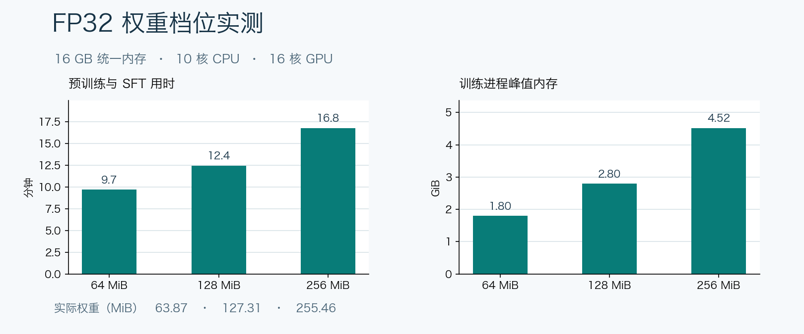

# MetaI — 全链路大模型研发框架

MetaI 使用 Rust、Burn 和 CubeCL，覆盖数据处理、模型训练、对齐、推理与评测。面向百万 token 上下文和万亿参数 MoE 的集群训练是长期工程目标。

- **模型与推理**涵盖 GQA、MLA、MoE、稀疏 KV 选择、分页缓存、投机解码和 INT4 量化。
- **训练与对齐**包括 预训练、断点续训、SFT、LoRA、DPO、PPO、GRPO、GSPO、CISPO、AI 反馈、自适应思考和蒸馏。
- **实验模型**覆盖 工具调用与 Agentic RL、Jev 类校准决策、视觉与视听问答、Omni、线性注意力和掩码扩散语言模型。

[中文教程](docs/COURSE.zh-CN.md) · [工程规格与验收](docs/INDUSTRIAL.zh-CN.md)

## 本地权重档位

1 MiB = 1,048,576 字节。三个档位共用 16K 词表，按写盘后的 FP32 BurnPack 大小验收。

| 档位 | 实测权重 | 参数量 | 层数 | 本机检查点 |
| --- | ---: | ---: | ---: | --- |
| 64 MiB | 63.87 MiB | 16.74M | 4 | `artifacts/weights/64-mib` |
| 128 MiB | 127.31 MiB | 33.37M | 6 | `artifacts/weights/128-mib` |
| 256 MiB | 255.46 MiB | 66.96M | 8 | `artifacts/weights/256-mib` |

本机检查点由 Git 忽略。64 和 128 MiB 为基准 SFT 权重，256 MiB 为随后加入对照句续训的权重。训练与评测使用自备的授权数据。



图中是同轮基准的 256 步预训练与 4,096 步 SFT，用时含模型载入和保存。256 MiB 的资源数据取后续对照句续训前的基准轮。三档在同一批 30 道中英互译题上分别译对 0、0、1 道，仍处于研发阶段。

## 运行

```bash
cargo test --locked
cargo run --locked -- --help
python3 scripts/run_size_tiers.py check 64 artifacts/weights/64-mib
```

从头训练、替换自己的数据、验证权重以及运行决策与视听示例，见[中文教程](docs/COURSE.zh-CN.md)。
