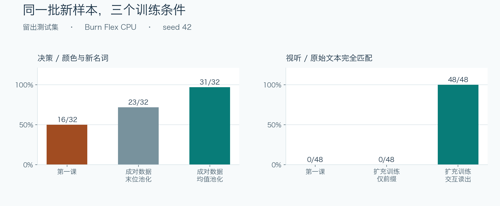
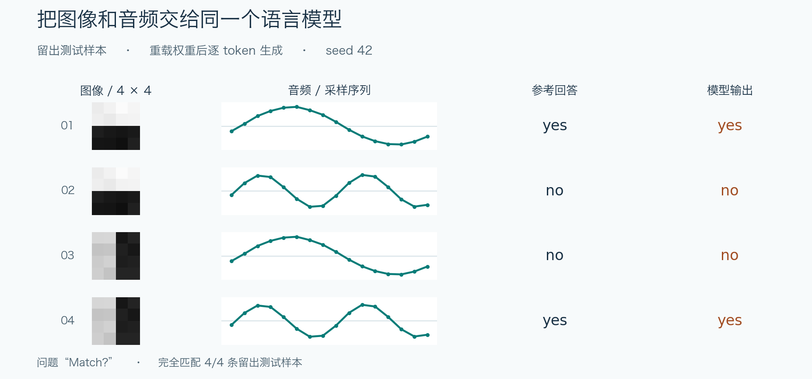

# MetaI 中文实验教程

这套课程追踪同一个问题：文本经过哪些变换才能得到梯度？阅读时准备纸笔，把一个批次里的样本数记作 B，序列长度记作 S，隐藏宽度记作 H，词表大小记作 V。每课先跑实验，再用输入、输出和损失解释结果。以下命令从仓库根目录执行，同一终端中依次使用。

Apple Silicon GPU 实验从逐句授权、数据去重、125M 预训练和 SFT 延伸到原始回答。先读[第一版双语实验](M2_BILINGUAL.zh-CN.md)，再用[完整字节词表与源句置换实验](M2_BILINGUAL_V2.zh-CN.md)检查模型会不会随原文改变译文。[125M 翻译对照实验](TRANSLATION.zh-CN.md)进一步区分训练句记忆、未见词义搭配和真实日常句的翻译。[真实日常句双向翻译](DAILY_TRANSLATION.zh-CN.md)固定训练步数，逐句检查情态、否定、数量和时态。

## 第一课　准备数据并观察第一个预测

```bash
R=$(mktemp -d)
D=examples/tiny
cargo build --locked
M=./target/debug/metai
python3 scripts/clean_corpus.py "$D/corpus.utf8" "$R/data"
cat "$R/data/train.txt"
head -n 2 "$R/data/manifest.jsonl"
"$M" pretrain --train-path "$R/data/train.txt" --valid-path "$R/data/valid.txt" \
  --output-dir "$R/base" --checkpoint-dir "$R/epochs" --num-epochs 3
"$M" generate --model-dir "$R/base" --prompt "the sky" --max-len 4
```

1. 清洗器对每行应用 Unicode NFC、合并空白、过滤过短文本和残余控制字符。完全相同的规范化文本先合并，再按种子和 SHA-256 排序切分。原始文件的两行 `one plus one is two.` 只进入一个集合。清单保留来源行号和内容摘要，当前样本得到训练 10 行、验证 2 行。跨文档近重复或同一作者的内容仍可能泄漏，实际语料还需按来源分组并检查近重复。
2. Byte-level BPE 先提供 256 种字节和四个特殊符号，再从训练集学习合并规则。验证文本从未参与合并规则拟合。`config.json` 的 V 是最终分词器大小，可能小于申请的词表上限。本轮分词器得到 V=285。现有分词器也可用 `--tokenizer-path` 载入，结构词表上限须容纳其 ID。
3. 假设分词得到 `[a,b,c,d]`。输入是 `[a,b,c]`，目标是 `[b,c,d]`。右侧补齐后，每一行都成为等长整数数组，训练按非 padding 目标取平均。验证 NLL 是所有有效目标的负对数似然之和除以有效 token 数。给定样本的困惑度为 `exp(NLL)`，比较模型时必须使用相同分词和评测样本。
4. `src/model/mod.rs` 先将 token 映射为 `[B,S,H]`。每层执行归一化、注意力和残差相加，再执行归一化、专家前馈和第二次残差相加。最终归一化和输出投影产生 `[B,S,V]`。AdamW 接收反向传播产生的梯度，修改模型参数。这里的 tiny 只有一层，H=16、两个查询头、一个 KV 头。H 小仍然能暴露 mask、维度或权重保存错误。

**动手查错。** 翻到 `src/train/mod.rs` 的 `token_logps`。它先在 V 轴上做 log-softmax，再按目标 ID gather，输出 `[B,S]`。若沿序列轴归一化，训练也可能输出有限损失。尝试手算词表大小为 2、两个 logits 均为零时一个 token 的 NLL，应为 ln(2)。

## 第二课　专家、注意力与断点

MoE 的路由矩阵把每个 token 的 H 维向量映射成 E 个分数。每个专家是含门控的 SwiGLU，选中位置经过 gather、专家计算、权重乘法、scatter-add 返回原位置。tiny 选择两个专家中的两个，方便比较与排查梯度。把 `active_experts` 改为 1 才会跳过另一个专家的前馈。top-1 若只对一个入选值做 softmax，权重会恒等于 1。本项目用全部专家上的 softmax 概率选出 top-1，使选中权重仍可向 gate 传梯度。当前未加入专家容量限制或跨卡分发。

GQA 让多个查询头共享一组 K/V。RoPE 旋转 Q 和 K 的对应维度，因果 mask 限制每个位置只读到自身和历史。解码缓存必须记住位置偏移和历史 padding，多 token prefill 也要应用因果 mask。MLA 变体在缓存中存放低秩表示和位置通道。可在一次实验中只改一个配置字段。

```bash
python3 - "$R/base/config.json" "$R/mla.json" <<'PY'
import json, sys
cfg = json.load(open(sys.argv[1]))
cfg.update(attn={"Mla":{"kv_lora_rank":8,"qk_rope_head_dim":4}}, active_experts=1)
with open(sys.argv[2], "w") as f:
    json.dump(cfg, f)
PY
"$M" pretrain --config "$R/mla.json" --tokenizer-path "$R/base/tokenizer.json" \
  --train-path "$R/data/train.txt" --valid-path "$R/data/valid.txt" --output-dir "$R/mla"
"$M" resume-pretrain --model-dir "$R/epochs/epoch-2" --additional-epochs 1 \
  --train-path "$R/data/train.txt" --valid-path "$R/data/valid.txt" --output-dir "$R/resumed"
cargo test --locked --test curriculum
```

`--checkpoint-dir` 每个 epoch 留一份独立目录。恢复读取模型、AdamW 状态、已完成的 epoch、种子和学习率，并校验两份语料的摘要。当前预训练无 dropout；按 epoch 重建打乱顺序使重跑第三个 epoch 和连续训练第三个 epoch 可比较。集成测试要求两份结果的 logits 最大绝对误差小于 1e-5。后训练产物支持权重接力，PPO critic 和后训练优化器的中途恢复尚待实现。

## 第三课　SFT、LoRA 与蒸馏

```bash
"$M" train-sft --model-dir "$R/base" --data-path "$D/sft.jsonl" --output-dir "$R/sft" --num-epochs 2
"$M" generate --model-dir "$R/sft" --chat --prompt "1+1?" --max-len 4
"$M" train-lora --model-dir "$R/sft" --data-path "$D/sft.jsonl" --output-dir "$R/lora" --rank 4 --alpha 8
"$M" distill --model-dir "$R/sft" --data-path "$R/data/train.txt" --output-dir "$R/student" --temperature 2
```

**SFT。** 每条 JSONL 提供 `instruction`、可选的 `input` 和 `output`。训练和聊天推理共享角色模板。分词后，prompt 的掩码为 0，回答和 EOS 的掩码为 1。例如拼接后的掩码 `[0,0,1,1]`，右移后对应预测目标的掩码是 `[0,1,1]`，因此第一枚回答 token 也会被训练。超过上下文时从右侧截断，没有回答 token 的样本会被过滤。当前教程使用单轮数据。

**LoRA。** 冻结语言模型，只给输出投影 W 增加两个矩阵 A、B。前向结果为 `hW + (α/r)hAB`。A 随机初始化，B 从零开始，第一步输出与底座一致。本例训练 r(H+V)=1,204 个参数。保存时把增量并入 W，可直接用普通生成命令推理。目录另存适配器参数和 rank、alpha；用原始底座可以恢复适配前的预测。拓展练习是把适配点移到注意力 Q/V，比较参数数目和定量指标。[LoRA 原论文](https://arxiv.org/abs/2106.09685)

**蒸馏。** 教师和学生使用同一个分词器。温度 T 平滑每个有效位置上的教师分布，学生最小化 `T² KL(p_teacher(T) || p_student(T))`。教师输出脱离梯度图，学生从随机参数开始。tiny 教师的 H=16，学生 H=8、单专家。在相同输入上观察 KL 和生成差异；一个弱教师同样可以向学生传递错误。[知识蒸馏原论文](https://arxiv.org/abs/1503.02531)

## 第四课　偏好和在线奖励

```bash
"$M" train-dpo --model-dir "$R/sft" --data-path "$D/preferences.jsonl" --output-dir "$R/dpo"
for method in ppo grpo cispo; do
  "$M" "train-$method" --model-dir "$R/sft" --data-path "$D/sft.jsonl" \
    --output-dir "$R/$method" --group-size 4 --max-new-tokens 8
done
"$M" train-grpo --model-dir "$R/sft" --judge-dir "$R/base" --data-path "$D/sft.jsonl" \
  --output-dir "$R/ai" --max-new-tokens 2
```

| 方法 | 数据来自哪里 | 优化时固定什么 | 应观察什么 |
| --- | --- | --- | --- |
| DPO | 同一问题的 chosen / rejected 偏好对 | 起始参考策略 | 策略相对参考模型的偏好间距 |
| PPO | 当前策略实际采样 | 每批的旧策略概率、优势及初始参考策略 | 终局回报与逐位置 critic 预测的差距 |
| GRPO | 每个 prompt 的一组实际响应 | 组内标准化的奖励、旧策略概率、参考策略 | 同组奖励相同会令优势为零 |
| CISPO | 与 GRPO 同一采样过程 | 截断并停止梯度的重要性权重 | 超过裁剪边界时仍有 log-prob 梯度 |

**DPO 的手算。** 将回答 token 的 log-prob 求和，得到 chosen 和 rejected 各自的序列分数。策略的两者之差减去固定参考策略的对应差得到 m。损失为 `−log σ(βm)`。策略刚从参考模型加载时 m=0，首批损失应接近 0.693147。这里的两行算术偏好是人工编写的教学样例。偏好数据的来源应与算法名称分别记录。[DPO 原论文](https://arxiv.org/abs/2305.18290)

**在线更新。** 对每个 prompt 从未截断、温度为 1 的旧策略采样，记录回答及 EOS。在这批轨迹上固定旧策略 log-prob 后更新两次，因此第二次更新的概率比 `r=exp(logπ−logπ_old)` 可以偏离 1。PPO 和 GRPO 使用 `min(rA, clip(r)A)`；CISPO 用 `stop_grad(clip(r)) × A × logπ`。三者对回答位置统计，附加相对固定参考模型的采样 KL 项。PPO 采用终局回报、γ=λ=1、独立线性价值头；GRPO 和 CISPO 采用组内总体标准差。对称裁剪范围可通过 `--clip` 调整。本课复现目标函数的关键区别，未复制论文的训练规模或全部配方。[PPO](https://arxiv.org/abs/1707.06347) · [GRPO](https://arxiv.org/abs/2402.03300) · [CISPO](https://arxiv.org/abs/2506.13585)

**从规则到 AI 反馈。** 默认奖励读取样本 `output` 对照候选回答中的数值，并计入格式分。传入 `--judge-dir` 会改用冻结语言模型，根据题目和候选回答比较两个裁决字符串的条件似然，归一化后作为标量奖励。PPO、GRPO、GSPO 和 CISPO 均支持这两种反馈。示例判断模型只有少量预训练步数，打分能力需用独立人工标注核验。练习时固定模型、prompt 和种子，只切换奖励来源，找出两种评分分歧最大的样本。

**同一批 rollout 的 GSPO 对照。** `train-gspo` 在回答 mask 内对 log-prob 差先取逐序列均值，再做指数和裁剪。每条回答在批损失中权重相同。可以用下面的命令与 GRPO 固定模型、prompt、奖励和种子比较；以下裁剪值只是实验设置。[GSPO 原论文](https://arxiv.org/abs/2507.18071)

```bash
"$M" train-gspo --model-dir "$R/sft" --data-path "$D/sft.jsonl" --output-dir "$R/gspo" --clip 0.001 --beta 0
```

## 第五课　工具调用、Agentic RL 与自适应思考

```bash
"$M" train-agent --model-dir "$R/sft" --output-dir "$R/agent" --num-epochs 75 --learning-rate 0.03
"$M" play-agent --model-dir "$R/agent" --case 3 --imitation
"$M" play-agent --model-dir "$R/agent" --case 3
"$M" train-thinking --model-dir "$R/sft" --data-path "$D/sft.jsonl" --output-dir "$R/thinking" --budget 4
"$M" think --model-dir "$R/thinking" --prompt "1+1?" --max-len 4 --threshold 0.8
```

**工具环境。** 四个情形来自“卡片 0/1 × 可见/隐藏”。策略只能读到观察文本。它可以直接回答，也可以执行 Lookup 让环境把隐藏值写进下次观察。工具成本为 0.15，答对得 1、答错得 −1；重复查询结束回合。动作头只分配三种合法动作的概率。这里没有 shell、网络服务或自由文本工具解析。

先用最短正确轨迹监督训练动作头，保留 `tool-sft.bpk`；再让策略为每个情形采样六条轨迹。组内归一化回报乘上整条轨迹所选动作的 log-prob 之和，更新策略并保存 `agent.bpk`。环境返回的观察参与下一步计算。`traces.json` 记录状态、动作、奖励和终止位。比较两种头在隐藏卡片上的策略：猜测有一半机会碰对，观察单次成功轨迹容易高估能力。把四种情形完整枚举，能同时看出成功率和查询次数。

**隐状态思考。** 对每个待预测位置，从骨干隐状态出发重复一个共享变换，并在每步预测停止概率。第 k 步的退出质量是“此前都继续的概率 × 本步停止的概率”，最后一步接收剩余质量。训练目标是各步 token NLL 加计算成本的加权期望。推理在累计退出概率达到阈值或预算耗尽时真正跳出循环。输出中的 `latent_steps_per_token` 记录每个 token 用的迭代次数。对照 `--budget 1` 和 `--budget 4`，同时比较计算量和任务答案。此教学变体没有训练自然语言思维链。[PonderNet](https://arxiv.org/abs/2107.05407)

## 第六课　决策头与扩展架构

```bash
"$M" train-decision --model-dir "$R/sft" --data-path "$D/decision-train.jsonl" \
  --calibration-path "$D/decision-cal.jsonl" --test-path "$D/decision-test.jsonl" \
  --output-dir "$R/decision" --num-epochs 16 --learning-rate 0.01
"$M" decide --model-dir "$R/decision" --text "red cup"
for kind in vision omni linear diffusion; do
  "$M" lab "$kind" --output-dir "$R/$kind" --num-epochs 12 --learning-rate 0.01
done
```

**决策。** 用冻结语言模型最后一个有效 token 的表示训练分类头，标签按训练集排序固定。单独用校准集拟合温度，再在测试集报告 NLL、Brier、ECE、阈值覆盖率和选择性风险。只改变温度会改变概率，保持预测排序。详情和错误解读见[决策模型专题](DECISION_MODELS.zh-CN.md)。

**视觉和 Omni。** 视觉输入是带噪声的 4×4 灰度条纹，每个样本有水平或垂直方向。视觉课学习一个图像投影和问答头。Omni 增加 16 Hz 采样的一秒合成音频，用三个离散指令选择图像方向、音调类别或两者是否一致。模型拼接三个编码向量，再预测二元答案，并用两个解码头重建像素和波形。总损失为分类交叉熵加 0.1 倍的两项均方误差。测试集改变噪声种子，几何模式和音调类别相同。它展示三种输入联合学习；开放域图文理解、连续语音生成和流式同步仍是扩展课题。

**让文本骨干看见和听见。** 下面两组命令把相同的 SFT 权重接到实际的自回归解码器。每幅 4×4 灰度图切为四行，每段 16 点单声道音频切为四帧，各自经线性层投影到 H 维。连续前缀排在文本 embedding 之前，一起经过已有的 RoPE、注意力和 MoE 层。回答 token 的损失只更新投影层，语言骨干保持冻结。数据行包含 `image`、可选的 `audio`、`question` 和训练用的 `answer`。生成只读取感知输入和问题。

```bash
"$M" train-multimodal --model-dir "$R/sft" --data-path "$D/image.jsonl" --output-dir "$R/vlm"
"$M" generate-multimodal --model-dir "$R/vlm" --data-path "$D/image.jsonl" --max-len 2
"$M" train-multimodal --audio --model-dir "$R/sft" --data-path "$D/audiovisual.jsonl" --output-dir "$R/avlm"
"$M" generate-multimodal --model-dir "$R/avlm" --data-path "$D/audiovisual.jsonl" --max-len 2
```

两种模型分别增加 4 和 8 个前缀位置，必须计入上下文预算。本实验的目标是验证跨模态梯度和文本生成接口。开放词表回答的质量需要更强底座和独立图文评测。

**线性注意力。** 用正特征映射 φ(x)=ELU(x)+1，维护 `S_t=S_(t−1)+k_t v_tᵀ` 和 `z_t=z_(t−1)+k_t`，当前输出为 `q_t S_t / (q_t z_tᵀ+ε)`。输入只按时间前进，无需构造序列长度平方的注意力矩阵。宽度固定时，一次前向的递推步数随长度线性增加。示例生成器为易读性每次重算前缀，未优化跨调用缓存；自动微分也会保存反向所需状态。[Linear Transformers](https://arxiv.org/abs/2006.16236)

**扩散语言模型。** 同样学习四种八符号循环序列。固定第一个符号，随机选 1 至 7 个位置换成 MASK，并把遮挡比例输入去噪器。双向 MLP 读整段，只对遮挡位置计算交叉熵。生成从七个 MASK 出发，每轮填入一个最有信心的位置。对照线性模型逐 token 生成的顺序。两个实验都在这四种训练模式上检查能否学会规则；测试长序列泛化需要新任务。此处使用等权掩码预测和确定性解码，论文中的连续时间损失权重与采样器可单独实现比较。[Masked Diffusion Language Models](https://arxiv.org/abs/2406.07524)

<a id="heldout-comparison"></a>

## 第七课　用留出集检查两次改进

这一课从同一份一层、隐藏宽度为 16 的 SFT 权重出发，追踪两个具体错误。先用开发集选择训练方法，固定配置后才用测试集评分。历史案例 `red cup` 单独记录在 `cup_probes`，没有计入新测试集。

```bash
# 在仓库根目录运行。如果已有第一课完整产物，直接将它作为 --course 即可。
python3 scripts/run_tiny.py --output artifacts/lesson-01 --seed 42
python3 scripts/compare_tiny.py --course artifacts/lesson-01 --output artifacts/heldout-01
python3 scripts/plot_results.py artifacts/heldout-01/report.json artifacts/heldout-01/figures
```

**第一步，固定什么算“没见过”。** 决策训练、校准、开发、测试分别使用 16、4、6、16 个互不重叠的名词。每个名词与两种颜色成对，得到 32、8、12、32 条。视听训练、开发、测试分别使用 8、4、12 个不同种子的场景。每个场景有两张图、两段声音，交叉配成四条，分别得到 32、16、48 条。生成器同时改变图像亮度和像素噪声、声音振幅、相位和采样噪声，并检查跨集合的整张图和完整波形均无重复。推理文件已移除 `answer` 字段。样本摘要保存在报告的 `data_sha256` 中。[生成与评分代码](../scripts/compare_tiny.py)

**第二步，检验 `red cup` 的错误来源。** 先对旧权重交替输入 `red cup` 和 `blue cup`。旧头只取最后位置，红色概率分别为 46.05% 和 45.91%。原来的六条训练短语也允许模型单靠名词区分标签。现在让每个训练名词分别配红、蓝两色。保持数据、优化器和训练预算相同，比较末位池化与全句均值池化。开发集分别答对 8/12 和 12/12，最终测试分别答对 23/32 和 31/32。两个改进头都纠正了杯子案例。均值池化仍把 `blue sandal` 判成红色，概率为 99.62%。这说明八条校准样本选出的温度还会产生过度自信的预测。[概率、校准和按名词配对的指标](DECISION_MODELS.zh-CN.md)



**第三步，沿 token 找到乱码发生的位置。** 旧实现只训练图像和声音的前缀投影，语言骨干和词表输出层都冻结。第一课只有四条样本、一次梯度更新。用旧权重重放四条原始输入时，前两个 token 均为 `[183,157]`。在本轮 ByteLevel BPE 词表里，它们还原为字节 `F7 DD`，解码为两个 U+FFFD 替换字符。两步的原始预算也不足以拼出旧分词方式下的完整回答。把旧权重的预算放宽到六步，48 条新样本仍全部含替换字符。可以用下面的命令核对原始解码文本及 token ID。

```bash
M=./target/debug/metai
C=artifacts/lesson-01
H=artifacts/heldout-01
"$M" generate-multimodal --model-dir "$C/audiovisual" --data-path examples/tiny/audiovisual.jsonl --max-len 2
"$M" generate-multimodal --model-dir "$H/av-readout" --data-path "$H/data/av-test-inputs.jsonl" --max-len 6
```

**第四步，给两种感知输入一条可学习的词表输出路径。** `--train-readout` 分别把四个图像前缀、四个声音前缀投影为向量 `v` 和 `a`。逐元素组合 `v + a + v * a`，让同一张图配上不同声音时可以产生不同条件。与当前文本隐状态的线性投影相加并经过 ReLU，再投影到全词表，加回冻结语言模型的 logits。训练仍只监督答案和结束符。另一项设置 `--continuation-targets` 把问题模板和答案一起分词，核对模板 token 边界。这样独立分词默认添加的前导空格不会进入答案目标；样本本身写下的前导空格仍保留。[训练和生成实现](../src/labs/multimodal.rs)

两个扩充训练组使用相同的 32 条样本、续写分词、40 轮、批量 8、学习率 0.008，测试时均在全词表贪心生成，最多六个 token。只训练前缀的对照组为 0/48。再训练交互读出层后，48/48 条原始字符串逐字匹配，而且每条都自行生成 EOS。评分直接比较字符串，保留空格和替换字符。以第一组为例，`yes` 的 token 为 `[92,72,86,2]`，`no` 为 `[81,82,2]`，最后的 `2` 是结束符。



**动手练习。** 依次比较图中第一、二行和第一、三行，找出哪种输入改变了答案。仅看单一模态的策略在每个四元组中最多答对两条。本轮十二组都四条全对。要试新方法，可先加 `--development` 只评估开发集。若已看过发布的测试结果，再验证新想法时请预留另一批名词和场景。这里测量的是固定问句下对新噪声实例和新名词的泛化，真实照片、语音、新词序以及多训练种子的稳定性仍需独立实验。[逐样本报告与训练命令](experiments/heldout-v1.json)

## 换成自己的数据

先保留原始快照和授权说明，使用独立验证集。增大数据前依次检查 tokenizer 往返、回答起点、全 padding 或全遮挡、教师冻结、权重重载一致性和学习曲线。可手动制造一个所有 rollout 同分的 prompt，观察 GRPO 的组内信号消失。各阶段命令均接受 `--help`。用新输出目录保存每次实验，跨阶段直接传入产物根目录。

| 症状 | 检查方法 |
| --- | --- |
| 输出目录已存在 | 指向新的路径；要继续预训练，用 `resume-pretrain` 并指定新的输出位置 |
| 没有可训练样本 | 检查文本是否过短、prompt 是否占满上下文、偏好对是否两侧都有回答 |
| rollout 超出上下文 | 查看 `config.json` 的 max_seq_len，为 prompt 与 max_new_tokens 同时预留空间 |
| 旧权重缺少 config.json | Burn 0.19 的 bin 与当前 BurnPack 格式不同。旧权重可在旧版代码中读取，当前课程从新目录训练 |
| 训练 loss 下降，开放问题仍答错 | 先计算留出集质量并检查实际失败样本，再决定扩数据、模型宽度或训练步数 |

单设备 `pretrain` 的 `--chinese-path` 与 `--english-path` 继续作为训练和验证路径的历史别名。`train-cluster` 恢复为单机同步数据并行入口，其中这两个旧参数均指定训练语料，独立验证文件用 `--valid-path`。课程之外的 125M Metal 训练、CUDA 构建、梯度等价性和拓扑恢复命令见[工业规格与实机记录](INDUSTRIAL.zh-CN.md)。
