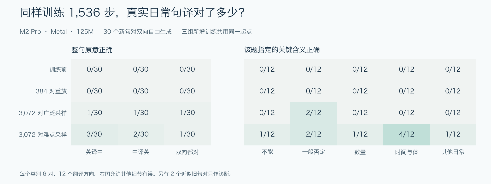

# 在 M2 Pro 上评测真实日常句翻译

上一轮 125M 模型能在受控句里区分“想要”和“不想要”，但把 `I can't drink milk.` 译成“我不喝牛奶。”。本轮直接从那份扩充组权重继续训练，用真实平行句检验能否保留能力、意愿、数量、时间和事件参与者。项目仍使用 Rust、Burn、CubeCL 和 Metal 上的同一套 125,276,928 参数骨干。[上一轮实验及权重来源](TRANSLATION.zh-CN.md)

## 选择训练语料

从有逐句署名的同一份 Tatoeba 快照中另选真实句对。先排除 v1、v2 的训练、开发和测试数据，以及 v3 的真实句和受控句。两侧任意句子 ID 重合即排除。文本去重采用 Unicode 规范化、英文大小写折叠和常见缩写展开，中文先通过 ICU 做繁转简，再移除空白与标点。训练及评测均保留原句的简繁体、标点和作者署名。训练组的并集共 3,890 个新句对，覆盖家庭、学校、工作、交通、饮食、购物、健康和休闲。[冻结语料、来源及许可证](../examples/daily-v4/README.md)

| 训练条件 | 不同句对 | 每对每个方向在整个训练中的出现次数 | 每轮指令 | 参数更新 |
| --- | ---: | ---: | ---: | ---: |
| 小语料重放 | 384 | 32 | 6,144 | 1,536 |
| 广泛采样 | 3,072 | 4 | 6,144 | 1,536 |
| 难点采样 | 3,072 | 4 | 6,144 | 1,536 |

三组各自加载 v3 扩充权重及其分词器，重置 AdamW，学习率 0.00015，batch 16，四轮，种子 42。优化器共处理 24,576 条指令。小语料取自广泛采样组。难点组先保留 1,536 个相同句对，另按英文表述选择 128 个否定能力或许可、320 个否定、256 个数量、448 个时间或体、384 个问句或常见祈使句。候选按稳定哈希排序，每个补充名额只使用一次。最终广泛组与难点组共享 2,254 对，替换 818 对。相同步数和批量控制了训练样次数，实际目标 token 数仍随句长变化。

| 不同训练句对中的英语表述 | 小语料 | 广泛采样 | 难点采样 |
| --- | ---: | ---: | ---: |
| can't、cannot、couldn't 等 | 4 | 64 | 160 |
| not、n't、never 等否定标记 | 49 | 510 | 728 |
| 数词、数字或数量词 | 19 | 126 | 325 |
| 时间标记或进行体句式 | 38 | 385 | 709 |
| 问句或一组常见祈使句 | 60 | 558 | 763 |

这些是英语表层规则的命中数，同一句可在多行出现。词形多义、隐含的数量和汉语用词都需结合上下文理解。训练仅以回答及 EOS 计算 SFT 损失，两种语言都作为输入和输出。

### M2 Pro 实机账本

| 权重 | 实际监督 token（含 EOS） | 首轮 → 末轮平均批损失 | 训练墙钟时间 |
| --- | ---: | ---: | ---: |
| 小语料重放 | 297,408 | 1.0097 → 0.0020 | 645.54 秒 |
| 广泛采样 | 294,552 | 3.4418 → 0.3281 | 631.51 秒 |
| 难点采样 | 297,492 | 3.3336 → 0.3211 | 636.87 秒 |

时间含每组模型载入、训练及保存。三组共做 4,608 次全参数 AdamW 更新。小语料组拥有最低训练损失，它对 384 对训练句中每个翻译方向的曝光次数是另外两组的八倍。

## 冻结双向留出题

主评测有 30 个真实句对，每个方向各 30 题。五类各有 6 个句对，分别考查“不能／做不到”、一般否定、数量、时间或体，以及其他日常表达。最后一类含赠送物品、辨认身份、问句和请求。英译中和中译英共用同一语义样本。报告同时给出各方向和两个方向都答对的句对数。

初选集先按 ID 和规范化文本与历史数据去重。在查看模型输出前，又按英文词序人工核对近邻，发现“这张票三天有效”在旧预训练中有等义改写，偷苹果的问句在旧 SFT 中有单数版本。保留这两对作单列诊断，并用登富士山的次数、请求帮忙留座两个真实句对补位。原始冻结清单、补位记录与四份权重对全部 32 对的回答均保留。排重可以核对字面重合及已识别的近重复，同一题材里的惯用句式仍可能相似。[初始冻结](experiments/daily-v4-freeze.json) · [补位记录](experiments/daily-v4-protocol.json)

所有权重只接收翻译指令和单侧原句。greedy 解码最多 32 个新 token。用保存的 16K 分词器检查了全部 64 个问题的指令、原句及参考译文，共 192 项，均能逐字往返。参考译文含 EOS 为 5 至 21 个 token。

## 逐句按什么标准判断

每条输出有两个独立可读的判定。**整句通过**要求准确传达原句中的事件、参与者、修饰语、数量、时间、情态、否定范围和言语意图。简繁、同义词、正常省略和语序调整均可接受。以实际输入语言明示或能合理推出的含义为准，避免把参考译文的每个字都当作强制要求。**关键含义通过**要求指定含义与正确的事件或对象绑定。例如“我不骑马”没有表达“我不会骑马”，“三分钟”即使含有正确数字也不能代替“三公里”。反过来，汉语的“我想不起来”已经表达 `I can’t remember.`，无需硬译成“我不能记得”。关键含义正确而其余事实出错时，整句仍计错。这里按自然句逐项诊断，不同语法类别的题材和难度也会不同。[逐题标准](../examples/daily-v4/rubric.jsonl)

复核表只显示原句、参考、预先记录的标准和候选译文，隐藏权重名称。同题的相同原答只判一次，按内容散列打乱候选顺序。完全匹配自动通过，其余由 Codex 单一评阅者按原意判读并记录理由。真实句规模有限，报告的是这批题上的一次固定种子实验。

## 留出题实测与误差

| 训练条件 | 整句保留原意 | 与参考字面一致 | 指定关键含义正确 | 两个方向都正确 |
| --- | ---: | ---: | ---: | ---: |
| 训练前 | 0/60 | 0/60 | 0/60 | 0/30 对 |
| 小语料重放 | 0/60 | 0/60 | 0/60 | 0/30 对 |
| 广泛采样 | 2/60 | 1/60 | 2/60 | 1/30 对 |
| 难点采样 | 5/60 | 2/60 | 9/60 | 1/30 对 |

广泛组双向译对的原句是 `I didn't mean to say that.`。难点组保住这两条，另增加 3 条整句通过，英译中为 3/30，中译英为 2/30。新增关键含义通过 7 条。这是同一批题的配对变化。只有一个种子、每类六个句对，不能据此估算面向日常用户的成功率。

| 难点组表现 | 不能／做不到 | 一般否定 | 数量 | 时间与体 | 其他日常表达 |
| --- | ---: | ---: | ---: | ---: | ---: |
| 整句保留原意 | 1/12 | 2/12 | 0/12 | 1/12 | 1/12 |
| 指定关键含义正确 | 1/12 | 2/12 | 1/12 | 4/12 | 1/12 |

| 原句 | 训练前原答 | 广泛组原答 | 难点组原答 | 判定依据 |
| --- | --- | --- | --- | --- |
| `I didn't mean to say that.` | 我不想聽不到那麼。 | 我沒想那麼說的。 | 我沒想那麼說。 | 后两组均正确否定说这话的意图 |
| `I can't remember.` | 我走不了。 | 我無法去。 | 我不記得記得記得。 | 可辨出“我不记得”，重复词影响流畅度 |
| `We can't talk here.` | 我们提供。 | 我們不論這裡。 | 我们不能跟你说！ | 用出了“不能”，却把地点限制换成了听者限制 |
| `I'm three years younger than you are.` | 我比你比你比你。 | 我年約年約年約年。 | 我比你多三歲。 | 保住三岁，反转长幼关系 |
| `They got here yesterday.` | 他們在這裡這裡等。 | 昨天这儿玩了。 | 他們昨天到這裡。 | 到达这一事件与昨天正确对应 |
| 我們昨晚吃了咖哩飯。 | `We can't for coffee.` | `We ate ate pizz after colle.` | `We had lunch at home last night.` | 昨晚用餐保留，丢了咖喱饭，还加上在家 |
| 你还记得我们吗？ | `Why did you have tea?` | `You're invive don't you?` | `Do you remembering us?` | 问句原意清楚，助动词后应接 remember |

**能读懂与能直接使用之间仍有差距。** 五条按原意通过的译文中，“我不記得記得記得。”和 `Do you remembering us?` 有明显措辞缺陷。额外要求这两处也通顺，剩下 3/60。原意复核保留这两个通过项，同时展示原答。对数量和否定，错误常发生在词与事件的关系上。例如手表慢五分钟被译成“我的手錶慢了這個機。”，识别手表和快慢后依然没有译出量值。两个额外近似诊断句对共 4 个方向，四组的整句和关键含义均为 0/4。



全部 256 次生成均自行输出 EOS。按各自 token ID 重新解码，得到的文本与报告中的原答逐字一致。[各组逐题原答和署名](experiments/daily-v4-answers.md) · [自由译文评阅记录](experiments/daily-v4-review.jsonl) · [每题语义、token ID、训练和推理收据](experiments/daily-v4.json)

## 在同一台机器上重放

从仓库根目录运行。若本地已有上一轮权重，可直接使用 `artifacts/translation-v3/mixed` 和保留的 Metal 二进制。干净检出先按[上一轮教程](TRANSLATION.zh-CN.md)准备起点。平时从仓库内冻结的带署名子集构建 JSONL，无须下载。可选的 `--select-from` 用 SHA-256 匹配的上游 ZIP 重选，重选需要 ICU 的 `uconv`。

```bash
R=artifacts/daily-v4-replay
python3 scripts/daily_translation.py "$R" --train
python3 scripts/report_daily.py "$R" "$R/blind-review.jsonl" --worksheet
python3 scripts/report_daily.py "$R" "$R/report.json" --answers-md "$R/answers.md"
python3 scripts/plot_results.py "$R/report.json" "$R/figures"
python3 -m unittest discover -s scripts -p 'test*.py'
```

每份训练权重的 `training-report.json` 记录设备、参数量、更新数、监督目标数和训练配置。推理收据记录模型、二进制和纯问题文件的哈希。评分按题号与实际原答匹配评阅记录，重放产生新译文时，可以在 `blind-review.jsonl` 中填写每项的 `meaning`、`detail` 和 `reason`，再加 `--reviews "$R/blind-review.jsonl"` 生成该次实验的报告。训练好的检查点可直接用 `metai --device metal eval-chat --model-dir … --questions … --max-len 32` 复测自己的原句。
