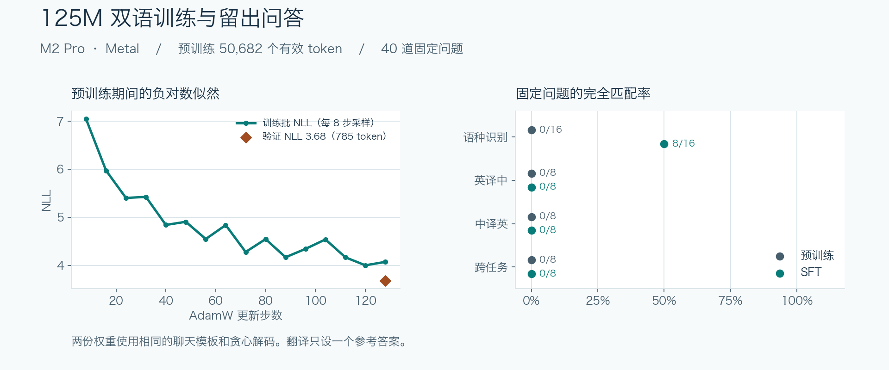

# 用 M2 Pro 训练并评测 125M 中英双语模型

这次实验检验一个从随机权重训练的模型，在读过一批真实中英短句、再做监督微调之后，能否翻译新句子、判断语种，以及按要求回答训练任务以外的问题。预训练、SFT 和逐 token 解码均在本机 Apple M2 Pro 的 16 核 GPU 上执行。硬件验收和框架的集群目标见[工业规格](INDUSTRIAL.zh-CN.md)。

## 语料、署名和留出方法

ManyThings 的 2026-02-13 普通话 / 英语快照包含 32,028 个 Tatoeba 社区句对。实验选取英文 3–14 个词、中文 3–40 个字符且含有汉字的样本，两边都须有句子 ID、贡献者和 CC BY 2.0 France 标记。预训练数据涵盖日常表达，存在简繁体混用和多种合理译法。原文、每句署名、上游说明及许可随子集提供。[冻结语料及署名](../examples/m2-bilingual-v1/README.md) · [上游下载说明](https://www.manythings.org/anki/) · [Tatoeba 使用条款](https://tatoeba.org/en/terms_of_use)

按两边的句子 ID 计算带固定前缀的 SHA-256，再按摘要排序。任意一侧已有相同的规范化字符串便跳过整个句对。此处规范化采用 NFKC、大小写折叠、仅保留字母和数字。测试检查了本次划分之间重复的句子 ID 和规范化原句。日常表达仍可能有近义句，共用的翻译和语种识别指令也是实验设计的一部分。本历史实验使用随 v1 归档的旧 16K 分词器，其早期拟合语料无法由本次划分追溯。

| 划分 | 独立句对 | 如何使用 |
| --- | ---: | --- |
| 留出测试 | 16 | 每对产生一道翻译题和一道同源语种题，两个翻译方向各 8 道，两种语言各 8 道 |
| 预训练验证 | 32 | 16 个段落，共 785 个有效预测位置，用于测量验证 NLL |
| SFT | 256 | 每对仅派生一条示例。英译中、中译英、识别中文和识别英文各 64 条 |
| 预训练 | 2,048 | 中英各 2,048 个句子，每 4 个同语种句子拼成一段，以 EOS 分隔，共 1,024 段 |

另外手写了 8 道迁移题，算术、常识、短文阅读、精确抄写各有中英文一题。所有 40 道题在训练前写入 `questions.jsonl`，SHA-256 为 `7d419c72f473b17dc78d634e0ad3f8a900779b69a5cd1c243af10ed8e32c18cd`。两份权重答完后，评分脚本才按 ID 与参考答案合并。留出测试的 32 道同域题共享 16 个来源，不能当成 32 个相互独立的语料样本。

## 在新的目录完整重放

在仓库根目录运行。需要 macOS 上可用的 Metal 设备、Cargo 和 Python 3.9+。训练和评分脚本只使用 Python 标准库。以下命令直接从随仓库保存的授权子集恢复数据。也可向准备脚本传入相同 SHA-256 的原始 `cmn-eng.zip`，两条路径得到逐字节相同的训练和评测输入。

```bash
R=artifacts/m2-bilingual-replay
python3 scripts/prepare_bilingual.py examples/m2-bilingual-v1/subset.jsonl.gz "$R/data"
cargo build --locked --no-default-features --features metal
cp target/debug/metai "$R/metai-metal"
gzip -dc examples/m2-bilingual-v1/tokenizer.json.gz > "$R/tokenizer-v1.json"
python3 scripts/run_bilingual.py "$R" pretrain --tokenizer "$R/tokenizer-v1.json" --binary "$R/metai-metal" --batch 8 --epochs 1 --lr 0.0003
python3 scripts/run_bilingual.py "$R" sft --binary "$R/metai-metal" --batch 8 --epochs 2 --lr 0.0001
python3 scripts/run_bilingual.py "$R" evaluate --binary "$R/metai-metal"
python3 scripts/score_bilingual.py "$R" "$R/report.json"
```

训练使用 FP32、AdamW、种子 42、16 层 GQA，隐藏宽度为 768，每层有 12 个查询头、4 个 KV 头和一个宽度为 2,048 的 SwiGLU 专家。预训练进行 128 次参数更新。实际每段产生 29–82 个预测目标，模型上下文配置为 2,048。SFT 重载刚保存的预训练权重，使用新的 AdamW，每轮 32 次参数更新。聊天模板的指令与输入参与前向计算，损失仅覆盖回答及其 EOS。这样，同一个短回答“中文”在训练中的权重取决于它包含的有效 token 数。两阶段的平均批损失对应不同目标。

训练前另用预训练集的前 16 段做过两步 GPU 试跑。试跑从随机初始化开始，829 个训练目标，含初次内核准备、验证和写盘共 113.133 秒。正式预训练重新初始化，未加载试跑权重。125M 单专家 softmax 路径直接将全部 token 送给唯一专家，省去了逐层索引回读；路由权重仍参与同一自动微分图。

### 本轮训练读数

| 阶段 | 有效监督量 | AdamW 更新 | 墙钟耗时 | 损失 |
| --- | ---: | ---: | ---: | --- |
| 从随机权重预训练 | 50,682 个下一 token 目标 | 128 | 134.974 秒 | 轮平均批 NLL 4.911679。验证 NLL 3.681871，困惑度 39.72 |
| 从预训练权重做 SFT | 每轮 2,067 个回答及 EOS 目标，共 4,134 个 | 64 | 60.401 秒 | 两轮平均批 NLL 依次为 3.910814、2.572483 |

用预训练集的有效目标拟合一个忽略上下文的词频基线，对全部 16,000 个词项加一平滑。词项概率为 `(出现次数 + 1) / (50,682 + 16,000)`。在相同 785 个验证位置上，词频基线 NLL 为 6.257077，125M 模型为 3.681871。这说明它在相似的日常短句和句界上，能比单看词频更好地预测后一个 token。验证包括标点和 EOS，后面的问答测试进一步检查生成内容的用途。

正式预训练的端到端速度为每秒 375.5 个有效训练目标，计时包含数据读取、计算、验证和写盘。训练与 SFT 的两个 `model.bpk` 各为 501,123,840 字节。预训练额外保存 AdamW 状态，可以按 epoch 恢复。验证完成、写盘前，Burn 主分配器报告已用 1.50 GB，保留 3.42 GB；整机峰值没有在此次实验中采样。实测软件环境为 macOS 26.6.2、Rust 1.100.0、Burn 0.22.1 与 Rust tokenizers 0.23.2，Cargo 使用 dev 构建。

## 如何判读答案

`eval-chat` 每次加载一份权重，逐题清空 KV 缓存，套用 SFT 的同一模板，在全词表贪心解码，最多生成 32 个 token。保存生成的 token ID、解码文本和结束原因。对 prompt 的切除发生在 token 边界，原始回答中的空格、重复、乱码和空回答都保存在 [JSON 记录](experiments/m2-bilingual-125m.json) 中。

- **语种识别**要求生成“中文”或“英文”。两种语言各 8 题，恒答同一标签也会得到 8/16。按语言分项可识别这种偏置。
- **翻译**记录单参考的完全匹配，同时按方向统计字符二元组 micro-F1。逐题取相邻两字符、有重复时按较小次数计匹配，再对同方向所有题计算 `2 × 匹配数 /（生成二元组数 + 参考二元组数）`。它衡量表面重合，译文是否保留主语、动作和否定还需对照原句判断。
- **迁移题**要求短答案。完全匹配只做 Unicode NFKC 和首尾空白清理，保留大小写、内部空白和额外文字。全套保留 4 道含有词表缺失数字的题，因此还须结合下方的词表检查解释错误。

### 读一次实测结果

预训练权重在 40 道题里有 38 次只生成中文句号和空格，其余两次生成英文句点和空格。经 SFT，31 个回答为 `" 中文"`，其余 9 个都为 `" I don't have a little money."`。两份权重都能自行结束回答，均无 Unicode 替换字符。此处失败主要体现在内容与问题无关。

| 任务 | 预训练完全匹配 | SFT 完全匹配 | 判读 |
| --- | ---: | ---: | --- |
| 英译中 | 0/8 | 0/8 | SFT 对 8 题均直接给出语种标签，两阶段字符二元组 F1 都为 0 |
| 中译英 | 0/8 | 0/8 | SFT 对 8 题都给出同一英文句子。字符二元组 F1 从 0 升至 0.213，来自常见英文片段的重合 |
| 语种识别 | 0/16 | 8/16 | 恒答“中文”足以猜中全部中文题，英文题一题未中 |
| 训练任务以外 | 0/8 | 0/8 | 四个原始参考含缺失数字，另四个都能编码解码往返，模型也全部答错 |

以新输入“他剛成為一名校長。”为例，参考译文是 `He has just become a principal.`。预训练模型输出 `"。 "`，SFT 输出 `" I don't have a little money."`。换成语种识别指令，SFT 回答 `" 中文"`。不过改用英文输入 `It's not something that anyone can do.` 后，它仍回答 `" 中文"`。单看前一个命中样本会高估语种识别能力。这些句子的作者为 CK、Martha、fucongcong。[样本记录及逐句署名](experiments/m2-bilingual-125m.json)



### 检查已有分词器的表达范围

原词表缺 89 个 ByteLevel 基础符号。遍历全部 16,000 个词项，找不到任何含 ASCII 数字 `0`、`1`、`4`、`8`、`9` 的词项。模型无法用这份词表生成这些数字。8 道迁移题中，参考答案 `12`、`0`、`青橙47`、`MAPLE-731` 因此无法逐字输出。计分时 NFKC 可合并某些兼容字符，逐字可表达性检查针对原始文本。预训练的 2,048 个英文原句中有 14 个编码再解码后发生变化，中文也有 14 个。16 个留出句对在两种语言上均能往返还原。检查忽略 ByteLevel 自动添加的一个前置空格。[逐项检查结果](experiments/m2-bilingual-tokenizer.json)

可选审计使用 Python `tokenizers==0.22.1` 读取保存的 Rust 分词器。绘图使用 `matplotlib==3.10.8`，可用 `--font` 指定本地中文字体。

```bash
python3 scripts/audit_bilingual_tokenizer.py "$R/pretrain/tokenizer.json" "$R/data" "$R/tokenizer-audit.json"
python3 scripts/plot_results.py "$R/report.json" "$R/figures"
```

若想复核一个新问题，使用正式 SFT 权重和聊天模板。单题交互命令打印输入及续写；批量评测命令单独返回续写，适合评分。

```bash
"$R/metai-metal" --device metal generate --model-dir "$R/sft" --chat \
  --prompt 'What color is snow?' --temperature 0 --max-len 32
```
