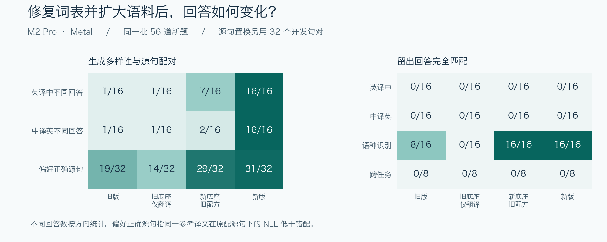

# M2 Pro 上的 125M 双语复验

第一次实验中，8 个不同中文句子都被译成同一句英文。此次复验先修复分词器，再用同一批新问题比较旧权重、新底座和两种 SFT 配方。训练设备、模型层数、隐藏维度和词表大小均与第一次相同。[第一次实验及其 40 道原题](M2_BILINGUAL.zh-CN.md)

## 从丢字符定位到词表

旧版 BPE 训练代码没有强制加入全部 ByteLevel 基础字节。随仓库保存的旧词表只有 167/256 个基础符号，BPE 也没有可用的未知词回退。已有的字节解码器只能解码已经进入 token 序列的内容。例如 `青橙47` 先丢掉 `4`，解码时已无法还原。另一个可独立复现的差异来自预分词器的 `add_prefix_space=true`，它会在原本没有前置空格的输入前添加一个空格。

修复后的 16K 词表保留前 15,911 个 ID，用末尾 89 个合并词的 ID 容纳缺失字节，并从合并表移除对应的最后 89 条规则。已有合并规则中对较早词项的引用仍然有效。新词表与新拟合的分词器都关闭自动补空格，新拟合时强制提供 256 个基础字节和四个保留标记。对带 `<pad>`、`</s>` 等字面字符串的存储文本使用 `decode_verbatim`；生成接口继续跳过模型发出的控制标记。旧权重须加载其工件目录中的旧分词器，按词表大小相等就互换会把部分 ID 解释成别的词。

逐字节基础符号检查为 256/256。完整 UTF-8 往返测试按最多 256 个码点一组，遍历 1,112,064 个 Unicode 标量值，另测 22,912 条真实中英句子、ASCII 控制字符、连续空格、全套数字、标点、组合字符、扩展汉字及 emoji，均得到原字符串。[逐项检查](experiments/m2-bytelevel-v2.json)

## 固定训练量、语料和问题

重用 ManyThings 的 2026-02-13 中英句对快照。每侧须有作者、句子 ID、CC BY 2.0 France 标记。先排除第一次实验全部 2,352 个句对中出现过的 ID 或规范化原句，再按固定哈希排序选取；任意一侧重复即跳过整对。冻结子集包含逐句署名，测试使用相同任务指令模板。规范化和 ID 检查可排除原句重用，近义句和共享短语仍然可能出现。继承的 BPE 合并规则早期拟合语料未知。[授权、来源和子集](../examples/m2-bilingual-v2/README.md)

| 用途 | 独立句对 | 实际构造 |
| --- | ---: | --- |
| 新题 | 32 | 16 道英译中、16 道中译英；前 16 个句对另测语种识别。再加 8 道中英算术、常识、阅读和抄写新题，共 56 题 |
| 诊断 | 32 | 每个翻译方向 16 对。固定指令和目标译文，在同方向内循环移动一个源句，得到匹配与错配条件 |
| 预训练验证 | 128 | 64 段，3,390 个目标 token |
| SFT | 3,072 | 每对训练两个翻译方向，每 8 对抽 1 对同时训练两种语种标签。共 6,144 条翻译、768 条语种识别 |
| 预训练 | 8,192 | 4,096 段。相邻放置原文和译文，两个句对交替使用英中、中英顺序，句间插入 EOS |

预训练从随机权重开始，FP32 AdamW、batch 16、学习率 0.0003、种子 42，一轮共 256 次更新。正式 SFT 重载新底座，用新的 AdamW、batch 16、学习率 0.0001 训练两轮。另从**同一新底座**加载第一次的 256 条 SFT 示例、batch 8 和学习率 0.0001，重复两轮，作为小配方对照。该对照同时改变双向监督量、任务比例、批量和更新次数，可以检验整套 SFT 配方的作用；各因素的独立贡献仍待消融。

正式预训练耗时 177.703 秒，处理 209,076 个目标 token。验证 NLL 3.468401。正式 SFT 耗时 369.580 秒，进行了 864 次参数更新，实际监督 147,684 个回答及 EOS token，两轮平均批损失分别为 3.570009 和 2.847263。时长包含各自加载与保存。预训练结束、写盘前主设备分配器保留 5.81 GB，这是单点读数。

用各自保存的分词器检查 SFT 输入，旧版 256 条记录得到 256 个不同的提示 token 序列，新版 6,912 条得到 6,912 个。旧版「提示＋目标」长 35–72 个 token，新版长 33–87 个，都在 2,048 的上下文范围内，原文和回答编码中均无 PAD。两边各自每轮有 2,067 和 73,842 个监督位置。这一检查可以排除源句在拼接时被统一截掉或所有输入被编码成同一串的解释。

另在**原 v1 底座和 v1 词表**上做任务配比消融。沿用原 256 个句对、行顺序、batch 8、两轮、64 次更新、学习率和种子，原来用于翻译的 128 行完全相同。将另外 128 道语种题改为同一原句的翻译题，总共每个方向 128 道。这个干预检验了固定标签的作用。由于译文更长，监督 token 数也随任务改变。

## 如何判断是否真的读了源句

1. 五份权重按相同顺序回答 56 题。两版均使用自身分词器、同一文字模板、全词表贪心解码，最多 32 个新 token，遇 EOS 或 PAD 停止。测试文件只含问题，SHA-256 为 `2a01d4ed09d3c2f56c432d65bc6e1e80ca2c92d29d04c83871f45097de1cbd0e`。单参考完全匹配采用 NFKC 和首尾空白清理。原答保留首尾空白与 token ID。
2. 每个翻译方向计算不同回答数、最高频回答次数及字符二元组 micro-F1。再把参考译文循环错开 1 到 15 个位置，对全部错配取平均 F1。原配和错配同分时，字面重合本身对模型是否读懂源句没有区分力。
3. 另用 32 个开发句对做教师强制评分。保持目标 token 和回答掩码不变，分别输入原配源句和轮换源句，计算含 EOS 的每 token 平均负对数似然（NLL）。记录两次编码确实不同，再统计多少译文在正确源句下 NLL 更低。逐题差值为错配减原配，正值表示模型更偏好正确对应关系。两份分词器的切词长度不同，应看各权重内部的配对差值。
4. 每份 SFT 权重另选开发集首个英译中和中译英问题，分别用 KV 缓存和完整前缀重算逐 token 贪心生成。按 token ID 核对，以区分训练行为与缓存实现差异。

5. 另逐题对照新旧 SFT 的 32 道译文和原文。完整传达主要动作或状态、参与者、关键对象、数量和否定才算语义通过。可以换词、使用简繁异体或改变不影响意思的语序。只译对部分词也保留原答，但计为未通过。这项复核由单一评阅者完成，独立于自动完全匹配分数。

## 实测回答和误差

新 SFT 的英译中、中译英各产生 16 种回答，旧 SFT 每个方向都只有 1 种。语种识别从恒答“中文”的 8/16 提升到 16/16，两种语言均为 8/8。迁移短答仍为 0/8。新词表可无损编码本轮全部 56 题的指令、输入和参考答案。新 SFT 的 56 次生成均在预算内自行输出 EOS，均没有 Unicode 替换字符。

英文 `I want something sweet.` 得到 `我想要一樣。`；中文“我咳嗽。”得到 `I'm sorry.`。前者抓住愿望却丢掉了“甜”，后者把症状变成道歉。单评阅者逐题比较了旧版与新版的两组共 64 条翻译，两版的语义通过数均为 0/32。[原文、译文和逐题理由](experiments/m2-bilingual-v2-review.json)

### 哪项干预改变了重复回答？

| 权重和训练条件 | 不同回答数，英译中 / 中译英（每向 16 题） | 32 个开发句对中更偏好正确原句 | 错配减原配的平均 NLL（nats/token） |
| --- | ---: | ---: | ---: |
| 旧底座＋原 256 条 SFT | 1 / 1 | 19/32 | +0.004 |
| 旧底座＋同 256 个句对，全部改为翻译 | 1 / 1 | 14/32 | +0.002 |
| 新底座＋原 256 条 SFT | 7 / 2 | 29/32 | +0.128 |
| 新底座＋扩大后的 SFT | 16 / 16 | 31/32 | +0.767 |

在同一旧底座上只改训练任务，单轮监督量从 2,067 增至 2,956 个 token。英译中的固定回答从 `" 中文"` 变成 `" 你必間。"`，中译英依然逐题输出 `" I don't have a little money."`。这说明固定语种标签会吸引生成结果；删去这些标签，在原来这点双语训练量下，模型依然几乎不利用原文。四份 SFT 权重分别在两道开发题上重算了完整前缀，8 组与缓存输出的 token ID 均完全一致。

旧配方在新底座上开始利用源句，新底座同时改变了预训练量、中英配对方式和分词器，无法单独归因于其中一项。随后在同一新底座上扩大翻译监督，原句错配引起的损失变化进一步增大。该结果支持“对原文有反应”，生成例子仍显示主语、动作、数量或否定容易丢失。

对新 SFT，英语译中文的原配 / 错配字符二元组 F1 为 0.0377 / 0.0050，中文译英语为 0.2564 / 0.1610。输入和输出已经有一定字面相关性。高频句式仍很明显，例如多个不同中文输入被续写成含 `a lot of` 的英文句子。

[逐题机器记录与开发集得分](experiments/m2-bilingual-v2.json)



## 在 M2 Pro 上重放

在仓库根目录运行。准备脚本也可接受校验和匹配的上游 ZIP。下方的 `OLD` 指向上一版的完整工件目录；首次从干净检出重放时，先按[历史实验教程](M2_BILINGUAL.zh-CN.md)恢复旧词表和权重。本轮数据准备、训练编排及主评分只使用 Python 标准库。独立词表审计使用 Python tokenizers 0.22.1，绘图使用 Matplotlib 3.10.8。

```bash
R=artifacts/m2-v2-replay
OLD=artifacts/m2-bilingual-v1
python3 scripts/prepare_bilingual_v2.py examples/m2-bilingual-v2/subset.jsonl.gz "$R/data"
python3 scripts/verify_bytelevel.py tokenizer.json "$R/data/attribution.jsonl" "$R/codec.json"
cargo build --locked --no-default-features --features metal --bin metai --example score_source
cp target/debug/metai "$R/metai-metal"
cp target/debug/examples/score_source "$R/score-source-metal"
python3 scripts/run_bilingual.py "$R" pretrain --binary "$R/metai-metal" --batch 16 --epochs 1 --lr 0.0003
python3 scripts/run_bilingual.py "$R" sft --binary "$R/metai-metal" --batch 16 --epochs 2 --lr 0.0001
python3 scripts/run_bilingual.py "$R" evaluate --binary "$R/metai-metal"
python3 scripts/compare_bilingual_runs.py "$R" "$OLD" "$R/metai-metal" "$R/score-source-metal"
python3 scripts/compare_bilingual_runs.py "$R" "$OLD" "$R/metai-metal" "$R/score-source-metal" --task-ablation
python3 scripts/report_bilingual_v2.py "$R" "$OLD" "$R/report.json"
python3 scripts/plot_results.py "$R/report.json" "$R/figures"
```
