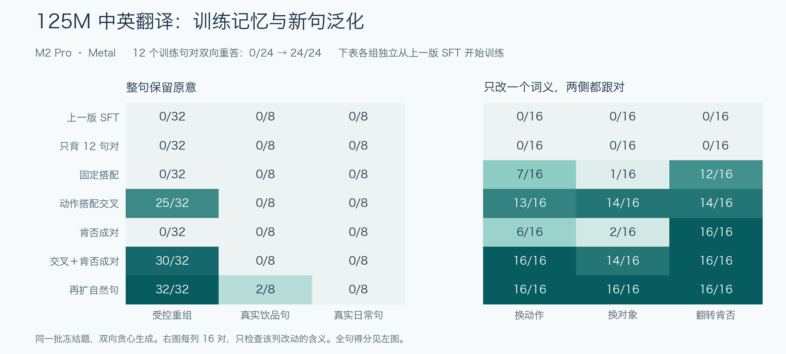

# 在 M2 Pro 上区分译文记忆和翻译能力

上一轮 125M 权重遇到不同原句已会给出不同回答，但 32 道新翻译题都丢了原意。本轮沿用同一份预训练、SFT 权重和 16K 分词器，在 Metal 上做全参数 SFT。模型的输入仍是翻译指令和原句，生成时看不到参考答案。所有实验共用 32 个新 token 的贪心上限。[上一轮实验](M2_BILINGUAL_V2.zh-CN.md)

## 第一步　检查训练样本能否译对

从有逐句署名的 Tatoeba 快照选 12 个新句对，每个方向都训练，共 24 条指令。用 batch 8、AdamW、学习率 0.00015、种子 42 跑 80 轮，共 240 次更新。保存并重载权重，在原来的 24 条提示上自由生成。用已保存的分词器单独核对过，24 个训练问题的指令、原句、参考译文共 72 项全部逐字往返。参考译文连 EOS 长 4–13 个 token。训练时每个位置看得到正确的上一词，推理时模型只能用自己刚生成的词。对比这两种条件，可以检出损失下降但整句解码失败的问题。实测这 240 次更新连同加载与保存共耗时 80.69 秒，平均批损失从第一轮的 3.338896 降至末轮的 0.001027。重载后 24/24 逐字命中，原权重重答同一批问题按原意为 0/24。这份权重随后回答全部 48 道新题，按原意为 0/48。例如“妮娜喜欢果汁。”被译成了训练中背过的 `Think before you act.`。记忆实验权重单独保存，后续每组重新加载上一轮 SFT 权重。

## 第二步　只改变词义搭配的训练分布

例如把 `Nina likes juice.` 分别改成 `Nina wants juice.`、`Nina likes water.`、`Nina does not like juice.`。三次分别只改动作、对象和肯否，主语不变。为了让三种变化都能单独测试，构造了两个这样的八句集合，每个集合有 2 个动作 × 2 种饮品 × 2 种肯否。每句双向翻译，共 32 道受控新题。训练构造的所有句子中都排除了这 8 种动作与对象的搭配。组成它们的每个词都见过。扩充组的真实文本及上一轮自然语料仍可能含这些词的搭配。

训练用四个主语、六个动词、六种饮品。固定搭配时，一个动作只配一个对象。交叉搭配时，一个动作可以配词表环上三个相邻对象，各动词和名词的总出现次数相同。固定肯否时，每个主语与动作只有一种肯否，所有样本中肯定、否定各半。肯否成对时，同一主语、动作、对象同时出现肯定和否定译文。

| 训练组 | 动作与对象搭配数 | 同一主语和动作的肯否 | 不同受控句对 |
| --- | ---: | --- | ---: |
| 固定搭配 | 6 | 固定 | 24 |
| 只交叉动作与对象 | 18 | 固定 | 72 |
| 只对照肯否 | 6 | 两种 | 48 |
| 交叉搭配＋肯否成对 | 18 | 两种 | 144 |

四组每轮均取 144 个受控句对样次，双向各译一次，再重放相同的 32 个自然句对，共 352 条训练指令。样本少的组靠重复对齐样次数。四组使用相同的优化器设置、相同的旧权重、batch 16、16 轮和 352 次更新。固定、只交叉两组每轮各监督 3,222 个回答及 EOS token，另两组各为 3,216 个。四组训练分别耗时 137、146、141、141 秒，末轮平均批损失都在 0.0022 左右。这个设计检验在相同步数下把重复预算用来增加不同搭配的效果。另设扩充组，沿用交叉搭配和肯否成对的设计，在每轮追加 256 个双向自然句对，含饮品题材 84 对、其他日常表达 172 对，共 864 次更新。这一组每轮监督 9,008 个目标 token，训练耗时 338.46 秒。它同时增加了训练文本和更新量。

在上一版的 3,072 个真实 SFT 句对里，把英语动词按常见屈折形式合并后，这六个动词和六种饮品只有 13/36 种组合在同一句出现。例如，like 与 coffee 同现 5 次，与 juice 和 water 均为 0 次。共现统计包含比较句等不同句式，不能直接当作动宾标注。下面的对照实验才能测出改变监督搭配带来的影响。

## 第三步　用真正的新原句检验迁移

独立选择 16 对 Tatoeba 自然句，其中 8 对涉及饮品，8 对涉及其他日常事情，每组各有 4 道英译中和 4 道中译英。含疑问、否定范围、动作时态、数量、地点和祈使句。它们是为诊断人工挑选的小样本，不能用来估算整个 Tatoeba 或上线流量的准确率。全部测试句与既有 v1、v2 的训练、验证和测试数据一起查重。先按 NFKC 规范化、折叠大小写、仅保留字母数字，再检查任一语言是否有重合。自然句另按两侧句子 ID 去重，且与受控句隔离。语义相似的改写仍有可能出现。全部 48 道新题在训练前单独保存并计算 SHA-256。48 道题的指令、原句和参考译文共 144 项全部逐字往返，参考译文连 EOS 为 6–17 个 token，均在解码上限内。两条翻译方向共享受控句语义，不能视作 32 个独立语义样本。[冻结清单](experiments/translation-v3-freeze.json) · [真实句的授权及逐句署名](../examples/translation-v3/README.md)

逐句判定允许同义表达、简繁体和不改原意的措辞变化。受控句的主语、动作、对象、肯否都必须正确，多出矛盾含义也算错。能完整解析为受控语法的输出逐项比对，其余输出及真实句对照原文复核。真实句还要保留问句／陈述、关键数量、时态、指代、情态和范围。对 `I can't drink milk.`，只译出“不喝牛奶”会丢失“不能”的情态。另按单词义变化配对，每个方向各有八对，只有两端都正确表达被改动的词义、输出也有相应变化，才计作跟对一次。该指标允许句中其他部分出错。单独统计肯否时看译文主断言的肯定或否定形式，无法辨出断言时记错。即使否定形式正确，否定了错误动作或对象仍无法通过整句评测。

## 为什么旧权重会丢动作、对象和否定

在固定搭配组，训练时 `like` 总与 `coffee` 配对，`drink` 总与 `juice` 配对。遇到此前未出现的“喜欢果汁”，中译英得到 `Nina likes coffee.`，反向却得到“妮娜喝果汁。”。同一个新搭配，一个方向保留了动词、换掉宾语，另一个方向保留了宾语、换掉动词。交叉搭配组把两句都译对了。在相同的 352 次更新下，动作最小对照从 7/16 升到 13/16，对象从 1/16 升到 14/16。

单独提供肯否两面，肯否最小对照从 12/16 升到 16/16，但整句仍为 0/32，因为每个动作仍只与一个饮品配对。反过来，只交叉动作和对象时，`Nina wants juice.` 和 `Nina does not want juice.` 都被译为“妮娜不想要果汁。”。加入同一事件的肯定与否定后，两句分别生成“妮娜想要果汁。”和“妮娜不想要果汁。”。双因素组在新组合上英译中 14/16，中译英 16/16，两处错误均把点的茶换成啤酒。

这些干预表明，训练中动词、名词和肯否总以固定形式共现时，模型可以靠搭配猜词，把训练损失降到很低。打散这种关联后，相同骨干与优化器能在新组合上分别追踪这些含义。因果比较限于此处的受控训练分布。上一版还受预训练语料量、自然句式覆盖等因素影响，本轮没有分别改变那些因素。

## 自然句扩充带来了多少迁移

扩充组在受控题上英译中和中译英各 16/16。真实题中，饮品句从 0/8 提升到 2/8，其他日常句均为 0/8。`I'm drinking milk.` 得到“我正在喝牛奶。”，准确表达进行时，比参考“我在喝牛奶。”多一个“正”也应通过。“你喝啤酒吗？”得到 `Do you drink beer?`。按英文词序匹配在 v2 预训练、SFT 和本次扩充训练文本中找近邻，这两题分别与 `I'm drinking orange juice.`、`Do you drink coffee?` 相近，两个近邻都来自 v2 预训练。报告同时列出原句 ID、署名及全部 16 题的近邻。此处能确认对相近句式中的饮品做了正确替换。

`I can't drink milk.` 得到“我不喝牛奶。”，动作、对象和否定都出现，能力或许可这一层意义仍丢失。“我要一杯咖啡。”得到 `I want coffee.`，遗漏一杯。“我要的不是茶，而是咖啡。”得到 `I want tea to coffee.`，两种饮品都在，仍无法恢复哪一个被排除。其他日常题里，一打铅笔变成一支钢笔并新增丢笔事件。这些错误无法由字符是否相同或回答是否流畅判断。对全部来源和原答的语义复核由 Codex 单次完成，没有独立第二评阅者。[完整逐题对照](experiments/translation-v3-answers.md) · [模型、原始输出和计分](experiments/translation-v3.json) · [自由译文逐条评阅记录](experiments/translation-v3-review.jsonl)



## 如何重放和检查结果

先按[上一轮教程](M2_BILINGUAL_V2.zh-CN.md)恢复 125M 的 v2 SFT 工件。已在本机跑过上轮实验时，可以直接使用其二进制和模型目录。命令从仓库根目录执行。下例保留所有六份新权重，单份模型文件约 501 MB。各组顺序占用一张 GPU。

```bash
R=artifacts/translation-replay
B=artifacts/m2-bilingual-v2
python3 scripts/prepare_translation.py "$R/data"
diff docs/experiments/translation-v3-freeze.json "$R/data/manifest.json"
python3 scripts/run_translation.py "$R" "$B/sft" "$B/metai-metal"
python3 scripts/report_translation.py "$R" "$R/report.json" --answers-md "$R/answers.md"
python3 scripts/plot_results.py "$R/report.json" "$R/figures"
python3 -m unittest discover -s scripts -p 'test*.py'
```

准备脚本默认读取仓库内冻结的 316 个署名句对，`--select-from` 也可从校验和匹配的 ZIP 重建它们。训练目录各自持有 `model.bpk`、`config.json`、`tokenizer.json` 和 Rust 训练器写出的 `training-report.json`。编排脚本校验冻结数据，记录起点、二进制、训练数据、权重、推理提示的 SHA-256，以及训练耗时。离线评分类别、逐项比较及成对统计由[评分代码](../scripts/report_translation.py)计算。评阅记录按题号和实际回答匹配，只有原答相同才会复用。若另一次训练或改用其他权重产生新的自由译文，需逐句对照原意，为新增输出填写判定及理由后再汇总。本轮共保存 384 次自由生成，全部在 32 个新 token 以内自行发出 EOS。所有统计只来自这个种子的一次运行。
